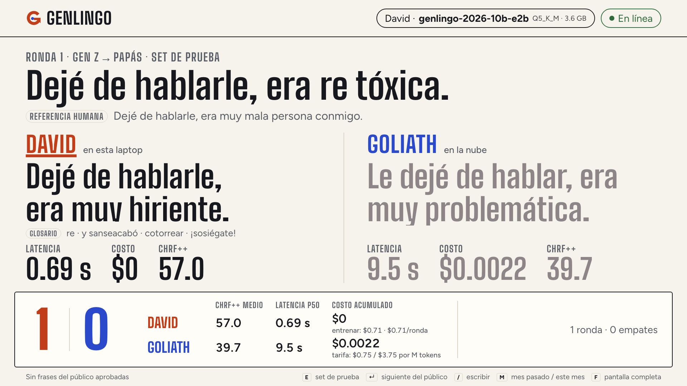
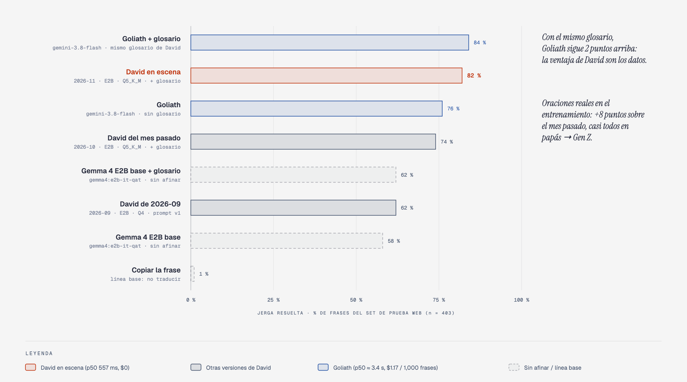
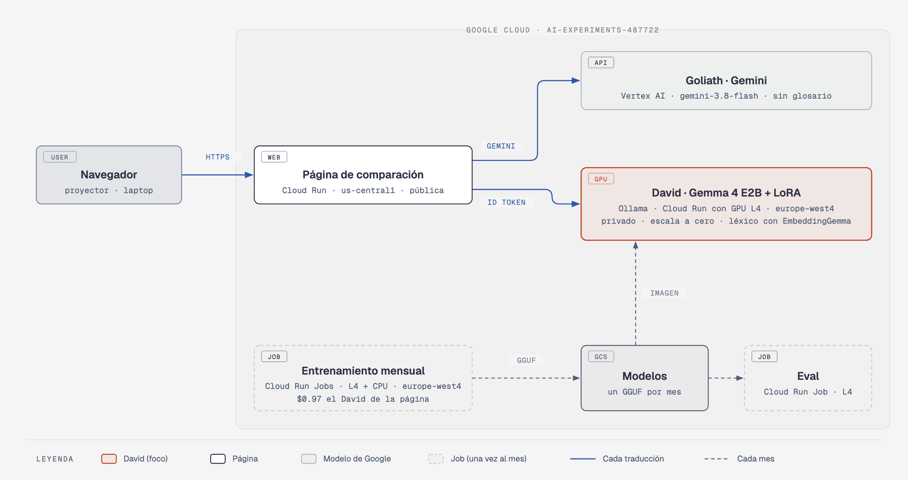
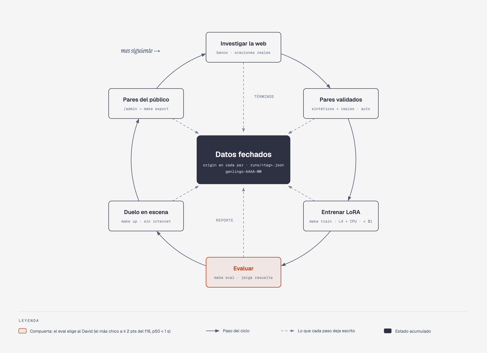
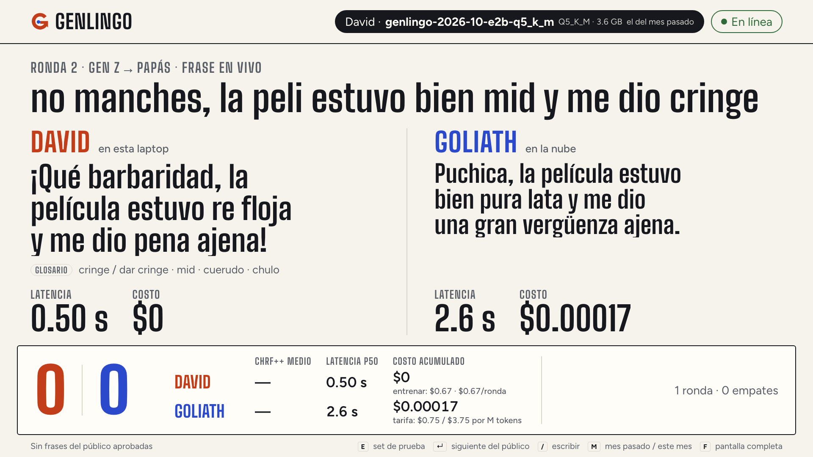
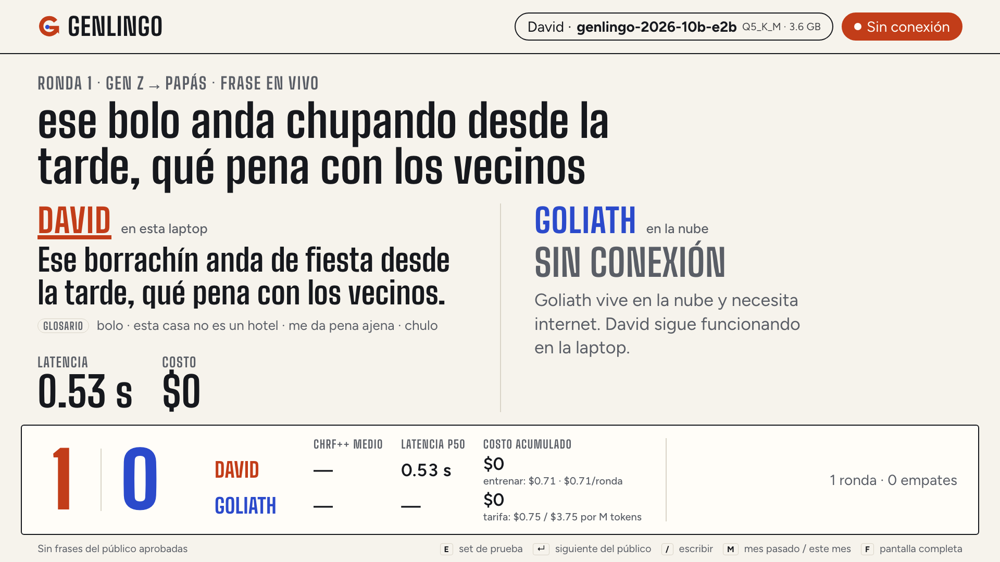
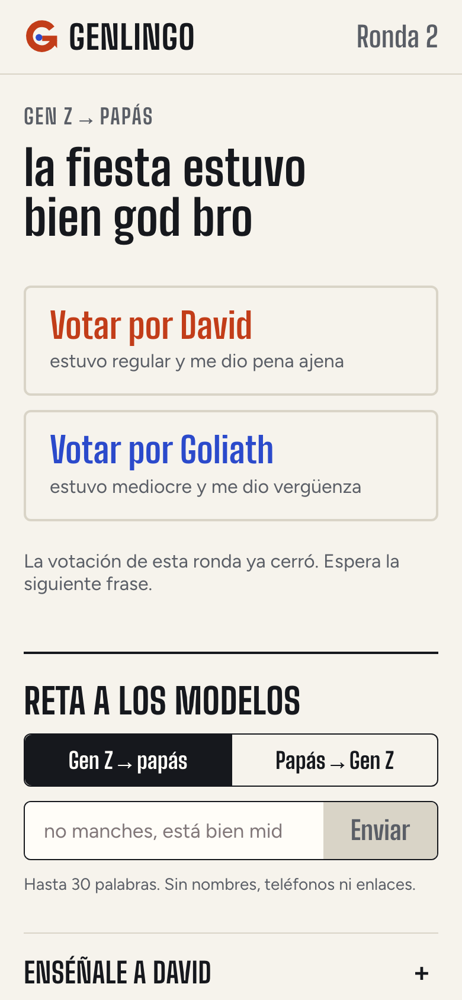

# Genlingo

**Generational translator: Gen Z ↔ parents.** Demo for the talk *"David vs. Goliath: cómo un modelo pequeño le gana a un modelo frontier"* (David vs. Goliath: how a small model beats a frontier model).

"no manches, la peli estuvo bien chilera pero el final me dio cringe" ↔ "la película estuvo bien chévere pero el final me dio pena ajena".

- **David** is Gemma 4 E2B fine-tuned with LoRA on our own pairs. It runs on the stage laptop with Ollama, **without internet**.
- **Goliath** is Gemini (`GEMINI_MODEL`, currently `gemini-3.8-flash`) on Vertex AI.
- The audience joins with a QR code, sends phrases from their phones and votes on who translated better. An objective metric compares both against human references.

Versión en español: [README.md](README.md) · Setup guide (Spanish): [docs/ONBOARDING.md](docs/ONBOARDING.md)

Audience app (Cloud Run): **https://genlingo-611681112050.us-central1.run.app**



## The result, without makeup

The result is mixed, and the talk tells it that way:

- **On slang handled, David beats plain Gemini:** the on-stage David (`genlingo-2026-10-e2b-f16` + glossary) handles the slang in **75%** of the test phrases; Gemini on its own, in **66%**. David answers in **~0.5 s** (p50 534 ms) and costs **$0** per phrase; Goliath takes **~5 s** (p50 5.22 s) and costs **~$1.10 per 1,000 phrases**.
- **With the same glossary, Goliath wins (82%).** David's advantage is not being a better model: it is **his data** (the researched, sourced and dated term bank), which Goliath doesn't have.
- **Compression costs slang:** the same David in Q4 (3.42 GB) handles 67% against 75% in f16 (9.27 GB).
- **chrF++ barely tells anyone apart:** returning the phrase untranslated already scores **50.0**; David f16 scores 51.9 and Goliath 52.1. That is why the term-level metric exists.
- **Retraining every month costs under $1** on a Cloud Run L4 GPU ($0.41 and $0.67 for the two E2B runs).
- **Big models age:** with the `M` key, last month's David (`genlingo-2026-09`, 55%) faces this month's (75%) live.

> The test-set references are still `pending_review`: these are rehearsal numbers and will change once the presenter approves or corrects the set (`make review-test`). Full details in [evals/report.md](evals/report.md).



## What you'll learn

| Lesson | Where it lives in the code |
| --- | --- |
| **Own data with `origin`.** Every pair says where it came from: `web` (URL + license), `synthetic` (model + prompt version + seed) or `human` (event). Without that you can neither evaluate honestly nor retrain every month. | `duel/genlingo_duel/dataset.py` (the `Pair` schema validates provenance), [data/SOURCES.md](data/SOURCES.md), [data/DATASHEET.md](data/DATASHEET.md) |
| **Term bank and validated synthetic pairs.** 260 terms from 35 sources; Gemini generates *term-substitution* pairs anchored on the bank, and every pair is validated against the bank (expected term present, no slang from another country, the source slang is gone). Of 2,700 generated, 1,848 were valid; 1,500 are used. | `data/terms.jsonl`, `scripts/generate_pairs.py`, `duel/genlingo_duel/terms.py` |
| **LoRA on a Cloud Run GPU job.** One container trains (TRL + PEFT, r=16, alpha=32, lr 2e-4, 3 epochs), merges, exports GGUF with llama.cpp and publishes an Ollama Modelfile. Every run records its duration and cost in a file. | `train/train_lora.py`, `train/submit_job.py`, `infra/03-train-job.sh`, `train/runs/` |
| **The compression trade-off.** f16 vs Q4_K_M: size, latency and how much slang is lost. | `train_lora.to_gguf`, "Compresión" section of `evals/report.md` |
| **Honest evals with term metrics.** chrF++ plus a "copy the phrase" baseline, *slang handled* and *reference-change recall* against the bank; David's losses are published. No model judges another. | `evals/run_eval.py`, `evals/term_accuracy.py`, `evals/report.py` |
| **Monthly retrain and `david_tag`.** Models carry the date of their data (`genlingo-YYYY-MM`); the duel accepts `david_tag` to pit last month's David against this month's. | `Makefile` (`TAG`), `DuelRequest.david_tag` in `duel/genlingo_duel/main.py`, `M` key in `web/components/presenter/PresenterApp.tsx` |
| **Offline by design.** The network check is a 0.8 s TCP connect; with no network, Goliath shows as "sin conexión" (offline) and David keeps going. The glossary is retrieved with a local EmbeddingGemma and cached embeddings. | `duel/duel_core/connectivity.py`, `duel/duel_core/duel.py`, `duel/genlingo_duel/glossary.py` |

## Architecture



Editable source: [docs/diagrams/arquitectura.html](docs/diagrams/arquitectura.html) (also as `.svg`). Diagram labels are in Spanish.

The monthly cycle, from data to stage and back:



## Quickstart

Requirements (versions in [docs/ONBOARDING.md](docs/ONBOARDING.md)): macOS on Apple Silicon, `uv`, Node 24, Ollama, `gcloud` with ADC.

```bash
cp .env.example .env                                  # models, prices and paths
(cd duel && uv sync)                                  # duel service (Python 3.12)
(cd web && npm install && cp .env.example .env.local) # presenter view and audience app
gcloud auth application-default login                 # Goliath (Vertex AI) and model downloads

ollama pull embeddinggemma                            # glossary retrieval
make pull-model TAG=genlingo-2026-10-e2b-q5_k_m      # on-stage David (Q5_K_M, 3.62 GB)
make pull-model TAG=genlingo-2026-09                  # last month's David (M key)

make up       # Ollama + warmed-up David + duel (:8787) + presenter view (:3000/presenter)
```

Rehearsal with no network or GPU: set `MOCK_AI=1` in `.env` and run `make up` (simulated, deterministic models).

## `make` commands

| Command | What it does |
| --- | --- |
| `make help` | Lists the commands with their description. |
| `make up` | Starts Ollama (with `OLLAMA_MAX_LOADED_MODELS=4`), preloads the three stage models (David, last month's David, EmbeddingGemma), brings up the duel service and the presenter view (rebuilt if its code changed). Works with Wi-Fi off and without an audience. |
| `make reset` | Zeroes local rounds, votes, queue and scoreboard; with `AUDIENCE_FEED=1` and network, also deletes the event's rounds in Firestore. |
| `make test` | Python tests (`MOCK_AI=1`), Vitest, `tsc`, ESLint and, with JDK 21, the Firestore rules on the emulator. |
| `make eval` | Runs the test set through the base models, every David and Goliath (with and without glossary) and writes `evals/report.md`. Accepts `EVAL_ARGS="--limit 50 --no-goliath"`. |
| `make test-set` | Builds the test pairs from real web sentences and validates them against the term bank (`auto_validated` or `rejected`, no human involved). |
| `make real-pairs` | Training pairs anchored in real sentences (both directions), validated against the term bank. |
| `make ambiguous-terms` | Flags term-bank entries that are also ordinary words («cámara», «servir») so metrics ignore them. |
| `make pairs` | Generates the synthetic training pairs with `GEMINI_MODEL` (paid; `SYNTHETIC_PAIRS_TARGET`, currently 1,500). |
| `make datasheet` | Recounts `data/DATASHEET.md`. |
| `make data` | `test-set` + `pairs` + `datasheet`. |
| `make review-test` | (Optional) exports the test set to a CSV for a human pass over the automatic validation. |
| `make review-test-apply` | Applies the CSV decisions (`a` approve, `r` reject, optional corrected reference). |
| `make export` | Pulls the audience pairs approved in `/admin` from Firestore into `data/pairs/human.jsonl` and recounts the datasheet. |
| `make train-data` | Renders the approved pairs into chat JSONL with the duel's exact prompt (and glossary). |
| `make train` | Trains on a Cloud Run Job with one L4: `make train TAG=genlingo-2027-03 [GEMMA_BASE_MODEL=…] [TRAIN_ARGS=…]`. Writes `train/runs/<tag>.json`. |
| `make train-finish` | Merges and exports to GGUF on the laptop an adapter trained in the cloud, and publishes it: `make train-finish TAG=…`. |
| `make train-local` | The same training on the Mac (MPS), for experiments. |
| `make quant-sweep` | From a David's f16 GGUF: Q5_K_M, Q6_K, Q8_0 and imatrix-calibrated Q4/Q5 (calibrated on training pairs), registered in Ollama. |
| `make pull-model` | Downloads a David from the bucket and registers it in Ollama: `make pull-model TAG=… [FP16=1]`. |
| `make deploy` | Creates the web service account and deploys the audience app to Cloud Run (`min-instances=1`). |

## Repo map

```
duel/                 Duel service (FastAPI) — runs on the laptop
  duel_core/          Reusable core: parallel duel, Ollama/Gemini/mock clients,
                      connectivity, cost with dated prices, chrF++, percentiles
  genlingo_duel/      The app: prompts, glossary, term bank, arena, scoreboard (SQLite),
                      Firestore bridge (audience_feed.py), API (main.py)
  tests/              Service tests (MOCK_AI=1)
web/                  Next.js: audience app (/), moderation (/admin), presenter view (/presenter)
  app/api/            Audience routes (phrases, pairs, votes, config) and admin routes
  lib/server/         Auth + App Check, 20 s limit, blocklist, validation, Firestore
  e2e/                Rehearsals with Playwright and with the Android emulator
  firestore.rules     No client writes directly; everything goes through the API
data/                 terms.jsonl, raw/web_usage.jsonl, pairs/, review/, SOURCES.md, DATASHEET.md
scripts/              Data building, review, export, reset, make up
train/                train_lora.py, submit_job.py, finish_local.py, train_local.py, notebook, runs/
evals/                run_eval.py, term_accuracy.py, report.py, report.md, experiments/
infra/                Numbered gcloud scripts (01–06) and shared env.sh
docs/                 ONBOARDING.md, diagrams/ (HTML + SVG + PNG), screenshots/
```

## Technical decisions

### What runs on the laptop, and why

| Component | Why on the laptop |
| --- | --- |
| **David** (fine-tuned Gemma, Ollama) | It is the thesis: a small model runs on your laptop, without internet and with no per-phrase cost. The latency that matters is the stage hardware's (M1 Max 64 GB), not a server's. |
| **EmbeddingGemma** (Ollama) | Retrieves the term-bank glossary with no network. The bank's embeddings are computed once and kept in `data/.cache/term_embeddings.json`. |
| **Duel service** (FastAPI + SQLite) | It must work with Wi-Fi off and measure latency on the stage machine. The local SQLite scoreboard makes `make reset` take under a second. |
| **Presenter view** (Next.js, local production build) | Offline mode: self-hosted fonts and a QR code generated in the browser, nothing is downloaded during the talk. |

When there is network, the duel also calls Goliath and, with `AUDIENCE_FEED=1`, receives approved phrases and publishes rounds to Firestore. With no network, all of that goes quiet and David keeps going.

### What runs in the cloud

- **Audience app** on Cloud Run (`us-central1`, `min-instances=1` so the QR code doesn't greet the room with a cold start). Firebase anonymous Auth (no sign-up), App Check with reCAPTCHA Enterprise, one phrase every 20 s enforced in a server-side transaction, a blocklist and presenter moderation in `/admin`.
- **Firestore**, database `genlingo`: phrases, rounds, votes (one per person) and audience pairs. The rules deny every client write; the `genlingo-web` service account can only touch that database (IAM condition).
- **Goliath**: Gemini on Vertex AI with ADC, `GOOGLE_CLOUD_LOCATION=global`, thinking level `low`.
- **Training**: a Cloud Run Job with a GPU in `europe-west4`; image built with Cloud Build into Artifact Registry `charlas2027`.

### Why Cloud Run GPU Jobs

One retrain a month doesn't justify anything running between runs. A Cloud Run Job with one L4 is serverless, billed per second while the task runs, and uses the same kind of image as everything else. `train/submit_job.py` computes the cost from the per-second GPU, vCPU and memory rates and writes it to `train/runs/<tag>.json`.

Two limits shaped the job (`infra/03-train-job.sh`): GPU tasks run for at most 1 h, and Cloud Run's filesystem lives in memory (32 GiB in total). So the base weights are cached on a Cloud Storage volume, while the merged model and the GGUFs go to the in-memory disk: reading and writing the GGUF over the bucket mount ran at ~3 MB/s (cancelled runs `kcwqz` and `kqlxv` in `train/runs/failed/`).

Alternatives not used as the main path, but available: a Vertex AI Custom Job with the same container (`TRAIN_RUNTIME=vertex`), the `train/genlingo.ipynb` notebook for Colab, and `make train-local` on the Mac (36.9 min for 1,000 pairs on MPS; on the L4, the training phase for the same size took 5.8 min).

### Why E4B finishes on the laptop (`make train-finish`)

Gemma 4 E4B trains fine on the L4 (282 steps, 24.7 min) and the LoRA adapter is saved to the bucket. But merging a 16 GB checkpoint and converting it to GGUF doesn't fit in the job's 32 GiB: the `genlingo-2026-10-e4b` run ended with "The configured memory limit was reached". The GPU-hungry part stays in the cloud and the RAM-hungry part runs on the 64 GB laptop: `make train-finish TAG=genlingo-2026-10-e4b` downloads the adapter, merges, quantizes to Q4_K_M and publishes to the same bucket, so `make pull-model` doesn't care where the merge happened. For large bases, `TRAIN_ARGS=--adapter-only` stops the job right after saving the adapter. E4B did not go on stage: with 67% slang handled and a p50 of 836 ms it doesn't beat the E2B f16.

### The glossary prompt

The `translate-v2` prompt starts with the country ("Variante: español de Guatemala. Usa solo expresiones de Guatemala…") because "chido" and "chilero" are the same word in different places. It ends with a four-entry glossary from the term bank, country-specific or neutral: first the source-generation terms that appear verbatim in the phrase, then the closest ones by meaning according to EmbeddingGemma. Retrieval time is added to David's latency.

David is trained on exactly that format (`make train-data` uses `v2+glossary` by default) and the duel reads from `train/runs/<tag>.json` which prompt each David was trained with: there is no gap between training and stage. Goliath gets `v2` without a glossary by default (`GOLIATH_PROMPT_STYLE`), because the bank is David's data; `make eval` also runs Goliath with the same glossary, which shows how much of the result is the model and how much is the data.

### The test set is web-only, never synthetic

A reference written by Gemini would reward Goliath for sounding like itself. The 319 test pairs come from real sentences found on the web; the reference is written by the curator from the meaning the source gives and reviewed by the presenter. The `Pair` schema rejects any synthetic pair in the test split. Audience pairs (`origin=human`) are split 80/20 between training and test by a stable hash of the id.

### Dated Gemini price schedule

Prices change, and that is part of the story. `GEMINI_PRICE_SCHEDULE=2026-09-30:0.75/3.75,2027-01-01:1.50/7.50` is a list of prices by date: every round and every eval uses the price in force that day and records which one it used. The report also shows what the same eval would cost at the 2027 price ($2.21 per 1,000 phrases instead of $1.10). Thinking tokens are billed as output. David's inference costs $0; the presenter view shows his training cost amortized per round. Exports of one training run (`-f16`, `-q5_k_m`, `-iq-q4_k_m`…) share its `train/runs/<tag>.json`.

### App Check enforcement is project-wide

`infra/06-app-check.sh` registers reCAPTCHA Enterprise as the App Check provider and, with `ENFORCE_FIRESTORE=1`, enforces App Check on Cloud Firestore. That enforcement is **per project**: App Check has no per-database policy, so any web or mobile client of any database in `ai-experiments-487722` will have to send App Check tokens. Server code (Admin SDK, IAM) is not affected. The API routes enforce it on their own with `APP_CHECK_ENFORCE=1`, which `infra/05-deploy-web.sh` turns on when `RECAPTCHA_SITE_KEY` is set. Automated tests and the emulator use a registered debug token.

### Who wins a round

- **Evaluation round** (test-set phrase, `E` key): the higher chrF++ wins; gaps under 0.5 are a draw. It uses `auto_validated` pairs (or ones a person approved), ready with no human review.
- **Live phrase** (typed with `/`) or **audience phrase** (from a phone): with the audience app connected (`AUDIENCE_FEED=1`) the vote decides (`V` closes voting); without an audience the round shows both translations with no winner. The whole talk works without an audience: `E` rounds and typed phrases.
- Audience phrases that pass the blocklist go straight to the screen queue (`AUTO_APPROVE_PHRASES=1`, the default); with `0` the presenter approves them in `/admin`.
- If Goliath has no network or fails, David wins by showing up.

## Results

Eval of 2026-10-01 on 319 web test pairs (references still `pending_review`). Slang handled: n = 304 judgeable phrases (298 for plain Goliath, which had 6 errors).

| Variant | Slang handled | Gen Z → parents | parents → Gen Z | chrF++ | p50 | Cost / 1,000 phrases | Size |
| --- | --- | --- | --- | --- | --- | --- | --- |
| Copy the phrase (baseline) | 0% | 0% | 1% | 50.0 | — | — | — |
| `gemma4:e2b-it-qat` (base) | 50% | 92% | 10% | 48.7 | 370 ms | $0 | 4.34 GB |
| `gemma4:e2b-it-qat` + glossary | 57% | 93% | 21% | 52.0 | 501 ms | $0 | 4.34 GB |
| `genlingo-2026-09` (last month, Q4) | 55% | 90% | 21% | 52.1 | 386 ms | $0 | 3.42 GB |
| `genlingo-2026-10-e2b` + glossary (Q4) | 67% | 95% | 40% | 51.2 | 496 ms | $0 | 3.42 GB |
| **`genlingo-2026-10-e2b-f16` + glossary (on stage)** | **75%** | 97% | 54% | 51.9 | **534 ms** | **$0** | 9.27 GB |
| `genlingo-2026-10-e4b` + glossary (Q4) | 67% | 94% | 41% | 52.4 | 836 ms | $0 | 5.30 GB |
| Goliath `gemini-3.8-flash` | 66% | 98% | 37% | 52.1 | 5.22 s | $1.10 | — |
| Goliath + the same glossary | 82% | 99% | 65% | 55.0 | 5.09 s | $1.17 | — |

**Honest reading.** Phrase by phrase, David handles the slang and Goliath doesn't in 51 phrases; the other way round, in 26. Against Goliath with the glossary, the count flips: 27 against 48. The hard direction is parents → Gen Z, and that is where the glossary and the rebalanced data (60% parents → Gen Z) help most. David wins on speed, cost and privacy, and wins on slang as long as the term bank is his alone. chrF++ stays glued to the copy baseline (50.0) because a register rewrite keeps almost every word: it can't decide who translated the slang.

David's ten worst losses and the per-country and per-direction breakdowns are in [evals/report.md](evals/report.md). The first version of the data (`pairs-v1`, free paraphrase) left David *below* the base model (chrF++ 39.1): it is documented in [evals/experiments/2026-09-pairs-v1.md](evals/experiments/2026-09-pairs-v1.md).

| `M` key: last month's David | Wi-Fi off |
| --- | --- |
|  |  |
| `M` key: `genlingo-2026-09` against Goliath on the same phrase. | No network: Goliath shows as "sin conexión" and David answers in 0.59 s (though he gets it wrong here: in Guatemala "bolo" means drunk and "chupando" means drinking). |

## Training cost per run

Cloud Run Job, 1× NVIDIA L4 without zonal redundancy, 8 vCPU, 32 GiB, `europe-west4`. Cost = billed seconds × per-second rates (`CLOUD_RUN_*_USD_PER_S` in `.env`).

| Run | Base | Pairs | Outcome | Duration | Cost |
| --- | --- | --- | --- | --- | --- |
| `genlingo-2026-09` | E2B | 1,000 (`pairs-v2`) | done (loss 2.33 → 0.14) | 17.4 min | $0.41 |
| `genlingo-2026-10-e2b` | E2B | 1,500 (`pairs-v3`) | done (loss 2.26 → 0.12) | 28.2 min | $0.67 |
| `genlingo-2026-10-e4b` | E4B | 1,500 (`pairs-v3`) | trained; out of memory while merging → `make train-finish` | 41.3 min | $0.98 |
| `failed/genlingo-2026-09-nv5r5` | E2B | 1,000 | failed at start (`gcc` missing for Triton) | 10.9 min | $0.26 |
| `failed/genlingo-2026-09-kcwqz` | E2B | 1,000 | cancelled: GGUF written to the bucket mount, too slow | 31.2 min | $0.74 |
| `failed/genlingo-2026-09-kqlxv` | E2B | 1,000 | cancelled at ~28 min (same cause, on read) | — | not recorded |
| `experiments/genlingo-2026-09-pairs-v1` | E2B | 1,000 (`pairs-v1`) | laptop, MPS | 36.9 min | $0 |

Generating the 1,500 `pairs-v3` synthetic pairs with Gemini cost $0.80 (6 min). A monthly E2B retrain costs under $1; David's inference, $0.

## Versions

| Piece | Version |
| --- | --- |
| David's base model | Gemma 4 E2B (`gemma-4-E2B-it`, Hugging Face weights `hf://google`); compared with E4B |
| Goliath | `gemini-3.8-flash` (`GEMINI_THINKING_LEVEL=low`) on Vertex AI |
| Local embeddings | EmbeddingGemma (`embeddinggemma` in Ollama) |
| Ollama | 0.35.0 |
| Training | torch 2.14.0 (CUDA 12.6), transformers 5.17.0, peft 0.21.1, trl 1.14.1, accelerate 1.15.0, datasets 5.0.1, llama.cpp `b11292` |
| Duel service | Python 3.12, fastapi 0.142.2, uvicorn 0.54.0, google-genai 2.25.0, sacrebleu 2.6.0, google-cloud-firestore 2.33.0 |
| Web | Next.js 16.3.8, React 19.2.8, firebase 12.19.0, firebase-admin 14.5.0, Node 24 |

Models come from environment variables (`GEMINI_MODEL`, `GEMMA_BASE_MODEL`, `LOCAL_MODEL_TAG`, `DAVID_PREVIOUS_TAG`, `DAVID_TAGS`, `BASE_MODEL_TAGS`, `EMBEDDING_MODEL`), documented in `.env.example`. The project uses no preview APIs (ADK, MCP, A2A).

## Data provenance and licenses

| Data | Origin | License / use |
| --- | --- | --- |
| `data/terms.jsonl` (260 terms) and `data/raw/web_usage.jsonl` | 35 web sources from MX, GT, CO and Latin America, accessed 2026-09-30 ([SOURCES.md](data/SOURCES.md)) | WikiLengua (CC BY-SA 3.0), Wiktionary (CC BY-SA 4.0) and diccionario-chapin (MIT) are reused under their licenses with per-record attribution. From all-rights-reserved sources only facts (a term and its meaning, paraphrased) and one short attributed quotation per entry are taken, for research and education. |
| `data/pairs/test_web.jsonl` (319 pairs) | Real sentences from those sources; the reference is the curator's rewrite (under 30% are curator-written sentences, marked `example_origin=curator`) | Same as the source; pairs quoting CC BY-SA examples inherit share-alike for that text. |
| `data/pairs/synthetic.jsonl` (1,500 pairs) | `gemini-3.8-flash`, prompt `pairs-v3`, base seed 2027; training only | Every pair records model, prompt version, seed and the term ids it was built from. |
| `data/pairs/human.jsonl` | Each event's audience, approved in `/admin` (`make export`) | Provenance: event and Firestore id. |

Known limitations (from the datasheet): Guatemalan youth slang is thinly documented online; slang ages fast; references are one person's, so chrF++ underestimates valid alternative translations.

## Deployed app

- Audience: **https://genlingo-611681112050.us-central1.run.app** (event `ensayo`, country `GT`)
- Moderation: `/admin` on the same URL (presenter account with `admin=true`)
- Presenter view: local, `http://127.0.0.1:3000/presenter` with `make up`


