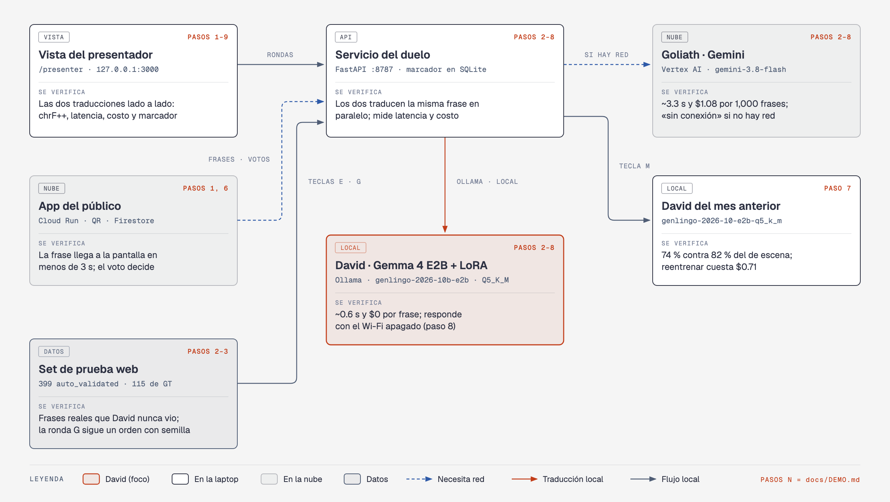

# Genlingo — traductor generacional: Gen Z ↔ papás

Demo de la charla *«David vs. Goliath: cómo un modelo pequeño le gana a un modelo frontier»*. «no manches, la peli estuvo bien chilera pero el final me dio cringe» ↔ «la película estuvo bien chévere pero el final me dio pena ajena». **David** es Gemma 4 E2B afinado con LoRA sobre pares propios y corre en la laptop del escenario con Ollama, **sin internet**. **Goliath** es Gemini (`GEMINI_MODEL`, hoy `gemini-3.8-flash`) en Vertex AI. El público entra con un QR, manda frases desde el teléfono y vota quién tradujo mejor; una métrica objetiva compara a los dos contra referencias humanas.

[English version](README.en.md)

## Qué vas a aprender

1. **Datos propios con `origin`:** cada par dice de dónde salió (`web`, `synthetic` o `human`); sin eso no se puede evaluar ni reentrenar cada mes.
2. **Banco de términos y oraciones reales:** 532 términos de 76 fuentes, contrapartes validadas por significado y 556 pares anclados en oraciones reales; la ventaja de David son sus datos.
3. **LoRA en Cloud Run Jobs:** una L4 entrena y un job de CPU fusiona y exporta GGUF; cada ejecución registra su duración y costo.
4. **El costo de comprimir:** f16 contra Q4_K_M, Q5_K_M, Q6_K, Q8_0 e imatrix, en tamaño, latencia y jerga perdida ([barrido y por qué Q5_K_M](docs/DECISIONES.md#cuantización-por-qué-q5_k_m)).
5. **Evals con métricas de término:** chrF++ más *jerga correcta*, *jerga resuelta* y *cambios acertados*, con un set de desarrollo aparte para decidir; las derrotas de David se publican.
6. **Reentrenamiento mensual y offline por diseño:** la tecla `M` enfrenta al David anterior con el de escena; sin red, Goliath sale «sin conexión» y David sigue.




## Resultado

Eval del 2026-10-04 sobre 399 frases de prueba web `auto_validated` ([tabla completa y salvedades](docs/DECISIONES.md#resultados)):

| Variante | Jerga correcta | Jerga resuelta | chrF++ | p50 | Costo / 1,000 frases |
| --- | --- | --- | --- | --- | --- |
| **David en escena** (`genlingo-2026-10c-e2b-nomulti`, Q5_K_M, 3.62 GB) | **42 %** | **82 %** | **59.7** | 670 ms | **$0** |
| David de la ronda 2 (`genlingo-2026-10b-e2b`) | 34 % | 82 % | 56.6 | 557 ms | $0 |
| David anterior, tecla `M` (`genlingo-2026-10-e2b-q5_k_m`) | 27 % | 74 % | 55.4 | 564 ms | $0 |
| Goliath `gemini-3.8-flash` | 26 % | 77 % | 53.5 | 2.60 s | $1.13 |
| Goliath + el mismo glosario | 38 % | 82 % | 57.0 | 3.05 s | $1.27 |
| Copiar la frase (línea base) | 1 % | 1 % | 53.2 | — | — |

*Jerga correcta*: la jerga producida significa lo que decía el original. David le saca 16 puntos a Goliath (IC 95 % [+10.8, +21.8]) y 30 en slang chapín. Con el mismo glosario, Goliath empata en el set completo, pero David sigue ganando en Guatemala y en papás → Gen Z: la ventaja de David son sus datos. Reentrenar cuesta $0.97 de punta a punta en la nube ([costo por ejecución](docs/DECISIONES.md#costo-de-entrenamiento-por-ejecución)).

## Lo que no funcionó

Una línea por callejón sin salida; el detalle está en [docs/BITACORA.md](docs/BITACORA.md).

- **Paráfrasis libres:** David quedó por debajo de copiar la frase.
- **Un modelo más grande (E4B):** la misma jerga resuelta que E2B y más lento.
- **Q4_K_M:** perdía 7 puntos de jerga contra f16.
- **Entrenar, fusionar y convertir en un solo job:** murió por memoria; ahora son dos jobs.
- **Contrapartes por *embedding*:** la mayoría de los enlaces significaban otra cosa.
- **Pares con 2–3 términos a la vez y preferencias ORPO:** ninguno mejoró el set de desarrollo; quedaron fuera.

## Arranque rápido

```bash
cp .env.example .env && (cd duel && uv sync) && (cd web && npm install && cp .env.example .env.local)
gcloud auth application-default login                 # Goliath (Vertex AI) y descarga de modelos
ollama pull embeddinggemma && make pull-model TAG=genlingo-2026-10c-e2b-nomulti   # léxico + David de escena
make up       # Ollama + David precalentado + duelo (:8787) + vista del presentador (:3000/presenter)
make test     # pruebas sin red (MOCK_AI=1)
```

Ensayo sin red ni GPU: `MOCK_AI=1` en `.env` y `make up`. Requisitos, el David anterior y la versión completa en [docs/COMANDOS.md](docs/COMANDOS.md#arranque-rápido).

## App desplegada

- Público: **https://genlingo-611681112050.us-central1.run.app** (evento `ensayo`, país `GT`); moderación en `/admin` (cuenta con `admin=true`).
- Vista del presentador: local, `http://127.0.0.1:3000/presenter` con `make up`.

## Documentación

- [docs/DEMO.md](docs/DEMO.md): guion de la demo, la página para traducir con David (cómo abrirla, qué ejemplos tocar, qué decir y qué hacer si algo falla).
- [docs/ONBOARDING.md](docs/ONBOARDING.md): instalación, nube, cadena de datos y entrenamiento, recorrido del código, problemas frecuentes y lista del día.
- [docs/BITACORA.md](docs/BITACORA.md): la historia de David iteración por iteración, con los callejones sin salida y los nichos.
- [docs/DECISIONES.md](docs/DECISIONES.md): lo que enseña la demo en detalle, cada decisión técnica, resultados completos y costo de entrenamiento.
- [docs/COMANDOS.md](docs/COMANDOS.md): todos los comandos `make` y el arranque rápido completo.
- [docs/ESTRUCTURA.md](docs/ESTRUCTURA.md): arquitectura, ciclo mensual, pantallas, mapa del repositorio y versiones.
- [docs/CREDITOS.md](docs/CREDITOS.md): procedencia de los datos y licencias.
- [evals/report.md](evals/report.md) y [evals/niche.md](evals/niche.md): reporte del eval y nichos definidos antes de mirar resultados.
- [docs/diagrams/](docs/diagrams/): arquitectura, qué se prueba, ciclo mensual, resultados y bitácora (HTML, SVG y PNG).
- [data/SOURCES.md](data/SOURCES.md) y [data/DATASHEET.md](data/DATASHEET.md): fuentes y datasheet de los datos.
