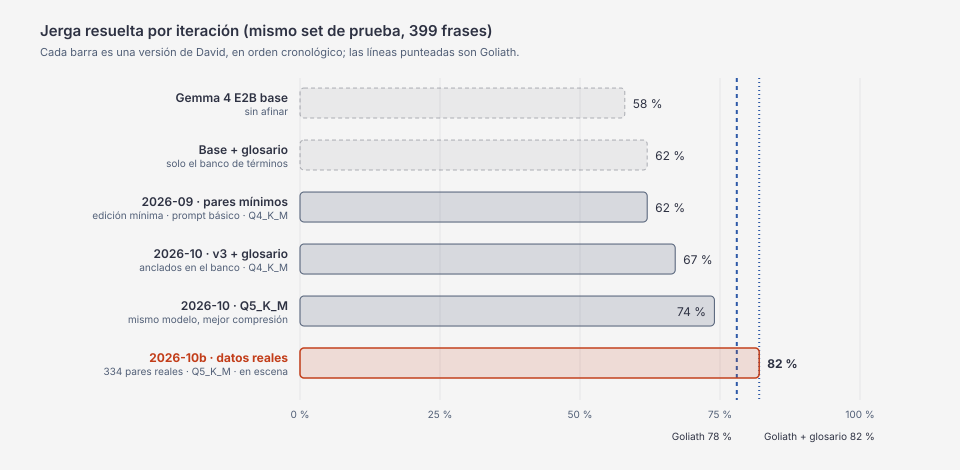

# Bitácora de David

La historia de David, iteración por iteración: qué cambió, por qué, qué salió, cuánto costó y cuándo.
Incluye los callejones sin salida, porque explican las decisiones que quedaron.

Los números de jerga resuelta son todos del **mismo set de prueba** (399 frases web `auto_validated`,
eval del 2026-10-02), así que se pueden comparar entre sí. Las ejecuciones viejas se reevaluaron sobre ese
set; los números de su momento (sobre sets anteriores) están en el historial de `evals/report.md`.

## Resumen

| Fecha | Iteración | Qué cambió | Jerga resuelta | Costo |
| --- | --- | --- | --- | --- |
| 2026-09-30 | Base sin afinar | Gemma 4 E2B tal cual | 58 % | $0 |
| 2026-10-01 | `genlingo-2026-09` | Pares de edición mínima | 62 % | $0.41 |
| 2026-10-01 | `genlingo-2026-10-e2b` | Pares anclados en el banco + prompt con glosario | 67 % (Q4) | $0.67 |
| 2026-10-01 | Barrido de cuantización | Q5_K_M en vez de Q4_K_M | 74 % | $0 (laptop) |
| 2026-10-02 | `genlingo-2026-10b-e2b` | Oraciones reales + banco de 406 términos | **82 %** | $0.71 |
| | Goliath (referencia) | `gemini-3.8-flash`, sin glosario | 78 % | $1.08 / 1,000 frases |
| | Goliath + el mismo glosario | El banco de David en el prompt de Gemini | 82 % | $1.24 / 1,000 frases |

## Callejones sin salida, en una línea

- **Paráfrasis libres** (2026-09-30): David aprendió a reescribir todo y quedó por debajo de no hacer nada (chrF++ 39.1 contra 50.0 de copiar la frase; [detalle](../evals/experiments/2026-09-parafrasis-libres.md)).
- **Un modelo más grande** (E4B, 2026-10-01, $0.98): la misma jerga resuelta que E2B (67 %) con p50 de 836 ms; más modelo no compró más jerga.
- **Q4_K_M**: perdía 7 puntos de jerga contra f16; Q5_K_M no pierde nada y pesa 3.62 GB.
- **Entrenar, fusionar y convertir en un solo job** (`zct96`, $0.63): murió por memoria, porque en Cloud Run el disco vive en la memoria; ahora son dos jobs.
- **Contrapartes por *embedding***: 175 de 217 enlaces significaban otra cosa («brainrot → patatús») y estaban en 1,065 de 1,375 pares sintéticos; quedan archivados solo como respuestas rechazadas.

## 1 · Pares de edición mínima (`genlingo-2026-09`)

La misma frase con solo los términos de jerga cambiados, generada por Gemini; primer entrenamiento en la
nube (Cloud Run con una L4, 17.4 min, $0.41). **62 %** de jerga resuelta, arriba de la base (58 %), pero
casi todo en Gen Z → papás: en papás → Gen Z resolvía el 20 %. Antes hubo tres ejecuciones fallidas que
también se pagaron (sin `gcc` para Triton, y el GGUF escrito en el bucket montado a ~3 MB/s).

## 2 · Pares anclados en el banco + glosario (`genlingo-2026-10-e2b`)

Cada par nombra un término del banco y su contraparte de la otra generación del mismo país, con trampas
de otro país como negativos difíciles y 60 % papás → Gen Z. El prompt empieza por el país y lleva un
glosario de cuatro entradas recuperadas con EmbeddingGemma; David se entrena con ese mismo prompt.
**67 %** en Q4_K_M y **74 %** en Q5_K_M tras el barrido de cuantización; papás → Gen Z sube de 20 % a 43 %.
$0.67 de entrenamiento y $0.80 de pares.

## 3 · Oraciones reales (`genlingo-2026-10b-e2b`, en escena)

Segunda ronda de investigación web: 22 fuentes, 146 términos y 420 oraciones reales. La mitad fue al set
de prueba; la otra mitad, a 334 pares de entrenamiento anclados en la oración real, en las dos
direcciones. **82 %**, +8 puntos, casi todo en papás → Gen Z (43 % → 59 %): supera a Goliath sin glosario
(78 %) y empata con Goliath + glosario (82 %). Entrenar, fusionar y cuantizar de punta a punta en la nube
costó **$0.71**. Se entrenó como `genlingo-2026-11-e2b` y se renombró: los tags llevan la fecha de los
datos (segunda versión de octubre).

## 4 · Set de prueba limpio

Dos frases de prueba estaban citadas dentro de pares de entrenamiento más largos. La validación ahora
compara subcadenas, crudas y normalizadas, contra todos los archivos de entrenamiento: 4 pares de prueba
fuera (403 → 399), quitados del set de prueba y no del entrenamiento porque David ya estaba entrenado.

## 5 · Contrapartes por significado (`genlingo-2026-10c-e2b-nomulti`)

La revisión de datos encontró el error de las contrapartes (arriba) y que, al entrenar, el término
correcto estaba en el glosario solo el 45 % de las veces. Esta ronda cambió los datos: contrapartes
validadas por significado (`data/counterparts.jsonl`; sin contraparte se dice el significado), 1,500
pares sintéticos regenerados con ellas ($0.71), un glosario de léxico con cada término, su contraparte,
términos cercanos y uno de otro país marcado «NO de aquí» (la respuesta está en el 85 % de los ejemplos),
más oraciones reales de Guatemala y Colombia (ronda 3: 532 términos de 26 fuentes) y un set de desarrollo
con métricas de significado registradas antes de calcularlas.

**Dev, 79 pares que ningún David vio** (10b entrenó con 67 de los 146 pares de dev, así que su número en
el dev completo es optimista):

| | chrF++ | Jerga resuelta | Cambios acertados | Jerga correcta | p50 |
| --- | ---: | ---: | ---: | ---: | ---: |
| `genlingo-2026-10b-e2b` (glosario) | 59.1 | 86 % | 18 % | 34 % | 601 ms |
| `genlingo-2026-10c-e2b` (léxico, con pares de 2–3 términos) | 62.8 | 86 % | 26 % | 35 % | 2.04 s |
| **`genlingo-2026-10c-e2b-nomulti`** (léxico, sin esos pares) | **65.9** | 86 % | 26 % | 35 % | 765 ms |
| `…-nomulti-orpo` (+ preferencias ORPO) | 66.2 | 76 % | 28 % | 31 % | 852 ms |
| Goliath (`gemini-3.8-flash`) | 49.3 | 74 % | 21 % | 18 % | 3.36 s |
| Goliath + el léxico de David | 58.1 | 89 % | 41 % | 42 % | 2.92 s |

- **Los pares de 2–3 términos no ayudaron:** sin ellos, chrF++ sube 3.1 y la latencia baja de 2.04 s a
  765 ms (el modelo dejó de alargar las respuestas).
- **ORPO no ayudó:** +0.3 de chrF++, pero la jerga resuelta en papás → Gen Z baja de 74 % a 55 %. Queda
  fuera. Antes de llegar a entrenar falló dos veces: el modelo se cargaba en la CPU para muestrear y,
  con lote 4, los logits de Gemma no cabían en la L4 (ahora lote 1 × 16).
- **Costo:** 10c $1.41, nomulti $0.97, ORPO $0.56 (más $1.81 de los dos intentos fallidos).

## Dónde gana David hoy, y dónde no

Nichos definidos antes de mirar resultados ([evals/niche.md](../evals/niche.md)); IC 95 % por bootstrap
pareado ([evals/niche_report.md](../evals/niche_report.md)).

| Nicho | n | David | Goliath | Δ | IC 95 % | Veredicto |
| --- | --- | --- | --- | --- | --- | --- |
| Slang chapín (GT) | 115 | 78 % | 70 % | +7.8 | [+0.0, +15.7] | empate estadístico |
| Papás → Gen Z (GT/CO) | 106 | 65 % | 49 % | +16.0 | [+3.8, +28.3] | **gana David** |
| Todo el set | 398 | 82 % | 78 % | +3.8 | [−0.5, +8.0] | empate estadístico |

- **Gana** en papás → Gen Z para Guatemala y Colombia: es justo lo que enseñan los pares reales.
- **En Guatemala** el límite inferior queda exactamente en 0: no alcanza para declarar victoria, aunque
  resuelve la jerga donde Goliath no en 16 frases contra 7 (chrF++ 61.2 contra 51.4).
- **Pierde o empata** contra Goliath con el mismo glosario en todos los cortes, y Goliath acierta más
  palabras de la referencia (30 % contra 22 %). Con los mismos datos, el modelo grande alcanza al pequeño:
  la ventaja de David son sus datos.

## Costo de reentrenar cada mes

Un reentrenamiento de E2B, de punta a punta en la nube, cuesta **$0.71** (25 min de L4 + 9 min de CPU).
En total, las ejecuciones con registro costaron $4.40, incluidas tres de las cuatro fallidas ($1.63; la cuarta, `kqlxv`, no dejó registro). La
inferencia de David cuesta $0; Goliath, $1.08 por 1,000 frases con la tarifa de hoy y $2.17 con la de 2027.

## Qué haríamos después

- **Más datos reales de Guatemala.** Es el nicho que todavía empata, y donde la web tiene menos.
- **Pares con varios términos a la vez.** David cambia menos palabras de la referencia que Goliath (22 %
  contra 30 %); los pares de un solo término le enseñan a cambiar uno.
- **Selección con el glosario.** Generar varias respuestas y quedarse con la que contiene más
  contrapartes esperadas del banco, sin pasarse de 1 s.
- **Un set de desarrollo propio**, para que las decisiones de datos nunca miren el set de prueba.
