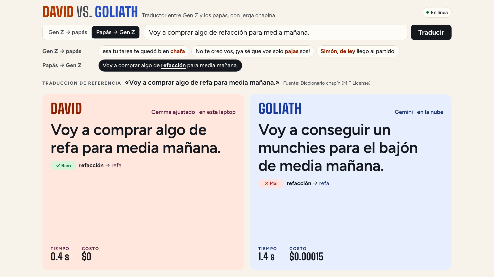
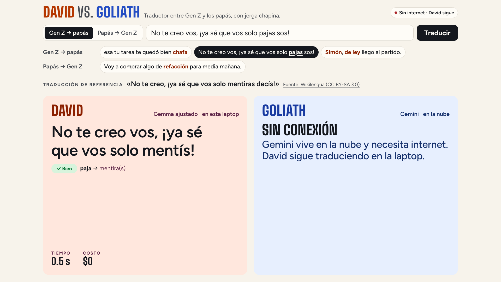

# Decisiones técnicas

Por qué Genlingo está hecho así: el resultado completo, el detalle de lo que enseña la demo, cada decisión técnica con lo descartado, la tabla del eval y el costo de cada ejecución de entrenamiento. Volver al [README](../README.md). [English version](DECISIONES.en.md).

## El resultado

El resultado es mixto, y la charla lo cuenta así:

- **Los datos con significado movieron la aguja.** El David de escena (`genlingo-2026-10c-e2b-nomulti`) se entrenó con contrapartes validadas por significado, un prompt de léxico (cada término con su contraparte, términos cercanos y uno de otro país marcado «NO de aquí»), 1,715 pares sintéticos regenerados con esas contrapartes y 556 pares anclados en oraciones reales, con más Guatemala y Colombia. Produce jerga con el significado correcto en el **42 %** de las 399 frases de prueba, contra **34 %** del David de la ronda 2 (`genlingo-2026-10b-e2b`), y chrF++ sube de 56.6 a **59.7**. La ronda se decidió en un set de desarrollo aparte; el set de prueba solo confirmó.
- **David gana a Gemini en jerga correcta:** 42 % contra **26 %** (+16.3 puntos, IC 95 % [+10.8, +21.8]; 101 frases las acierta solo David y 36 solo Goliath). Gana en slang chapín (52 % contra 23 %), en papás → Gen Z de Guatemala y Colombia (44 % contra 20 %) y en Colombia; en México empatan. En *jerga resuelta*, que no mira el significado, empatan (82 % contra 77 %). Responde en **~0.7 s** (p50 670 ms) y cuesta **$0** por frase; Goliath tarda **~2.6 s** y cuesta **$1.13 por 1,000 frases**.
- **Con el mismo glosario, Goliath empata en el set completo** (42 % contra 38 %), pero David sigue ganando en slang chapín (+17.4) y en papás → Gen Z (+16.0); en el español neutro (LATAM) gana Goliath (55 % contra 32 %). En cambios acertados quedan parejos (28 % David, 25 % Goliath, 29 % Goliath con glosario). La ventaja de David son **sus datos** (el banco de términos, las contrapartes y las oraciones reales, con fuentes y fecha) y haberse entrenado con ellos.
- **Comprimir no cuesta jerga:** el David de escena es el Q5_K_M (3.62 GB); con el David de la ronda 2, el Q5_K_M quedó a un punto del f16 (9.27 GB) con la misma latencia.
- **chrF++ casi no distingue a nadie:** devolver la frase sin traducir ya saca **53.2**; David 59.7, Goliath 53.5, Goliath con glosario 57.0. Por eso existen las métricas a nivel de término.
- **Reentrenar cada mes cuesta menos de $1, todo en la nube:** $0.97 de punta a punta (L4 para entrenar + CPU para fusionar y cuantizar).
- **Reentrenar con datos nuevos compra jerga:** el David de hace dos rondas de datos (`genlingo-2026-10-e2b-q5_k_m`) acertaba el 27 % de la jerga; el actual, el 42 %.

La historia completa, iteración por iteración (callejones sin salida incluidos), está en [BITACORA.md](BITACORA.md); los nichos donde David se mide contra Goliath, definidos antes de mirar resultados, en [evals/niche.md](../evals/niche.md).

> Las referencias del set de prueba se validan automáticamente contra el banco de términos (`auto_validated`); ninguna persona las revisó. Ningún par de prueba aparece en los datos de entrenamiento, ni siquiera dentro de una oración más larga. Las oraciones de prueba y los pares reales de entrenamiento vienen de la misma ronda de investigación (mitades disjuntas por hash), así que parte de la mejora puede ser cercanía a esas fuentes. Detalle completo en [evals/report.md](../evals/report.md).

## Qué vas a aprender, en detalle

| Lección | Dónde está en el código |
| --- | --- |
| **Datos propios con `origin`.** Cada par dice de dónde salió: `web` (URL + licencia), `synthetic` (modelo + versión de prompt + semilla) o `human` (evento). Sin eso no se puede confiar en la evaluación ni reentrenar cada mes. | `duel/genlingo_duel/dataset.py` (esquema `Pair` que valida la procedencia), [data/SOURCES.md](../data/SOURCES.md), [data/DATASHEET.md](../data/DATASHEET.md) |
| **Banco de términos, oraciones reales y pares sintéticos validados.** 532 términos de 76 fuentes y una tabla de contrapartes validadas por significado; Gemini genera pares de *sustitución de término* anclados en el banco, y cada par se valida contra el banco (término esperado presente, nada de jerga de otro país, la jerga del origen desaparece): el David de escena usa 1,715. A eso se suman 556 pares anclados en oraciones reales de la web. | `data/terms.jsonl`, `data/counterparts.jsonl`, `scripts/generate_pairs.py`, `duel/genlingo_duel/terms.py` |
| **LoRA en Cloud Run Jobs.** La misma imagen entrena en una L4 (TRL + PEFT, r=32, alpha=16 con rsLoRA, lr 2e-4, 3 épocas) y, en un job de CPU, fusiona, exporta GGUF con llama.cpp y publica un Modelfile para Ollama. Cada ejecución deja su duración y costo por etapa en un archivo. | `train/train_lora.py`, `train/finish.py`, `train/submit_job.py`, `infra/03-train-job.sh`, `train/runs/` |
| **El costo de comprimir.** f16 contra Q4_K_M, Q5_K_M, Q6_K, Q8_0 e imatrix: tamaño, latencia y cuánta jerga se pierde. | `train/quant_sweep.py`, `train_lora.to_gguf`, [Cuantización: por qué Q5_K_M](#cuantización-por-qué-q5_k_m) |
| **Evals con métricas de término.** chrF++ más una línea base de «copiar la frase», *jerga correcta*, *jerga resuelta* y *cambios acertados* contra el banco; las decisiones de datos se toman en un set de desarrollo aparte y las derrotas de David se publican. Ningún modelo juzga a otro. | `evals/run_eval.py`, `evals/term_accuracy.py`, `evals/report.py` |
| **Reentrenamiento mensual.** Los modelos llevan la fecha de sus datos (`genlingo-AAAA-MM`, con una letra si hay dos versiones de datos en el mes: `genlingo-2026-10b-e2b` es la segunda ronda de investigación de octubre y `genlingo-2026-10c-e2b-nomulti` la tercera, sin los pares de varios términos); la demo usa el de `LOCAL_MODEL_TAG`. | `Makefile` (`TAG`), `.env.example` (`LOCAL_MODEL_TAG`), `train/runs/` |
| **Comparación lado a lado.** Una página local donde David y Goliath traducen la misma frase con su tiempo y su costo, y una revisión ✓/✗ por término en los ejemplos verificados. | `duel/genlingo_duel/static/traducir.html`, `duel/genlingo_duel/translate_page.py`, `duel/genlingo_duel/term_check.py`, `data/translate_examples.json` |
| **Offline por diseño.** El chequeo de red es una conexión TCP de 0.8 s; sin red, Goliath aparece «sin conexión» y David sigue. El glosario se recupera con EmbeddingGemma local y embeddings en caché. | `duel/duel_core/connectivity.py`, `duel/duel_core/duel.py`, `duel/genlingo_duel/glossary.py` |

## Decisiones

### Qué corre en la laptop y por qué

| Componente | Por qué en la laptop |
| --- | --- |
| **David** (Gemma afinado, Ollama) | Es la tesis: un modelo pequeño corre en tu laptop, sin internet y sin costo por frase. La latencia que importa es la del hardware del escenario (M1 Max 64 GB), no la de un servidor. |
| **EmbeddingGemma** (Ollama) | Recupera el glosario del banco de términos sin red. Los embeddings del banco se calculan una vez y quedan en `data/.cache/term_embeddings.json`. |
| **Servicio del duelo** (FastAPI) | Sirve la página de comparación y llama a David y, si hay red, a Goliath. Tiene que funcionar con el Wi-Fi apagado y medir la latencia en la máquina del escenario. |
| **Página de comparación** (HTML servido por el duelo) | Tipografías propias servidas por el mismo servicio: nada se descarga durante la charla. |

Si hay red, el servicio también llama a Goliath. Sin red, Goliath dice «Sin conexión» y David sigue. El repositorio conserva la vista del presentador (Next.js, `/presenter`), con rondas y marcador en SQLite, de una versión anterior de la demo; la charla no la usa.

### Qué corre en la nube

- **App del público** en Cloud Run, de una versión anterior de la demo (frases y votos desde el teléfono); la charla no la usa, sigue desplegada y `make preflight` la revisa (`us-central1`, `min-instances=0` fuera de las charlas; `make stage-on` la sube a 1 y `make stage-off` la baja). Auth anónima de Firebase (sin registro), App Check con reCAPTCHA Enterprise, límite de una frase cada 20 s aplicado en una transacción del servidor, blocklist y moderación en `/admin`.
- **Firestore**, base de datos `genlingo`, de esa misma app: frases, rondas, votos (uno por persona) y pares del público. Las reglas niegan toda escritura de clientes; la cuenta de servicio `genlingo-web` solo puede tocar esa base (condición de IAM).
- **Goliath**: Gemini en Vertex AI con ADC, `GOOGLE_CLOUD_LOCATION=global`, razonamiento `low`.
- **Entrenamiento**: dos Cloud Run Jobs en `europe-west4` (L4 para entrenar, CPU para fusionar y convertir a GGUF); imagen construida con Cloud Build en Artifact Registry `charlas2027`.

### Por qué dos Cloud Run Jobs

Un reentrenamiento al mes no justifica nada encendido entre ejecuciones. Cloud Run Jobs es serverless, se cobra por segundo mientras la tarea corre y usa el mismo tipo de imagen que el resto. `make train` encadena dos jobs de la misma imagen (`infra/03-train-job.sh`):

| Job | Máquina | Qué hace |
| --- | --- | --- |
| `genlingo-train` | 1× L4, 8 vCPU, 32 GiB | Entrena el adaptador LoRA y lo guarda en el volumen del bucket (`ADAPTER_ONLY=1`). |
| `genlingo-finish` | solo CPU, 8 vCPU, 32 GiB, disco efímero de 10 GiB | Fusiona el adaptador, convierte a GGUF f16, cuantiza a `QUANT` (Q5_K_M) y publica en el bucket de modelos (`train/finish.py`). |

`train/submit_job.py` espera a los dos, calcula el costo de cada uno con las tarifas por segundo de GPU, vCPU y memoria, y deja el detalle por etapa y el total en `train/runs/<tag>.json`.

Por qué dividirlo: el sistema de archivos de Cloud Run vive en la memoria de la instancia. Entrenar, guardar un checkpoint fusionado de 10 GB y escribir un GGUF f16 de 9 GB no caben juntos en 32 GiB: la ejecución `genlingo-2026-10b-e2b` (`zct96`) murió por memoria al convertir a f16, y E4B ya había fallado igual al fusionar. En el job de CPU no queda nada del entrenamiento en memoria: los pesos base se copian del bucket con una lectura secuencial (cargarlos con `mmap` desde el bucket montado iba a ~5 MB/s), la fusión corre en un proceso hijo (devuelve sus ~10 GB al terminar), el checkpoint fusionado va al disco en memoria, el GGUF f16 va al disco efímero (respaldado en disco, no en memoria) y el checkpoint se borra antes de cuantizar. Además la GPU no se cobra mientras se fusiona y convierte. Los pesos base se cachean en un volumen de Cloud Storage que comparten los dos jobs; los GGUF no van ahí porque el convertidor escribe a saltos y sobre el bucket montado iba a ~3 MB/s (ejecuciones canceladas `kcwqz` y `kqlxv` en `train/runs/failed/`).

Descartado: Google Cloud Batch con una L4 y disco persistente. Resolvía la memoria en un solo paso, pero suma otra API, otra imagen de VM con drivers y otra cuenta de permisos, mientras que dos jobs reutilizan la imagen, la cuenta de servicio y el bucket que ya existían.

Alternativas disponibles: un Vertex AI Custom Job con el mismo contenedor y 200 GB de disco (`TRAIN_RUNTIME=vertex`, todo en un paso), el notebook `train/genlingo.ipynb` para Colab, y `make train-local` en la Mac (36.9 min para 1,000 pares en MPS; en la L4, la fase de entrenamiento de ese mismo tamaño tomó 5.8 min).

El ciclo de cada mes, de los datos al escenario y de vuelta:

### `make train-finish`: el respaldo en la laptop

`make train-finish` corre el mismo `train/finish.py` en la Mac de 64 GB: baja el adaptador del bucket, fusiona, convierte, cuantiza (`QUANT`, `KEEP_F16=1` para publicar también el f16) y publica en el mismo bucket, así que `make pull-model` no distingue dónde se hizo la fusión. Sirve cuando el job de CPU no puede correr, y para E4B: su checkpoint fusionado de 16 GB más el modelo en memoria no caben en 32 GiB ni en el job de CPU. E4B no salió a escena: con 67 % de jerga resuelta y p50 de 836 ms no supera al E2B f16.

### Cuantización: por qué Q5_K_M

Barrido del 2026-10-01 (`make quant-sweep`, `train/quant_sweep.py`) sobre las exportaciones de `genlingo-2026-10-e2b`, todas con el mismo prompt con glosario, en el set de prueba de ese día (319 pares). imatrix se calibró con pares de entrenamiento, nunca con el set de prueba. Resultados por frase en `evals/results/20261001-152529.json` (fuera del repo); la tabla completa está en el historial de `evals/report.md` (commit `bb3f9fb`).

| Cuantización | imatrix | Tamaño | Jerga resuelta | Cambios acertados | chrF++ | p50 |
| --- | --- | --- | --- | --- | --- | --- |
| Q4_K_M | no | 3.42 GB | 67 % | 13 % | 51.2 | 496 ms |
| Q4_K_M | sí | 3.42 GB | 72 % | 14 % | 51.6 | 539 ms |
| **Q5_K_M** | no | 3.62 GB | **76 %** | 14 % | 51.5 | 587 ms |
| Q5_K_M | sí | 3.62 GB | 75 % | 15 % | 52.2 | 624 ms |
| Q6_K | no | 3.83 GB | 74 % | 15 % | 51.9 | 527 ms |
| Q8_0 | no | 4.95 GB | 75 % | 14 % | 51.9 | 532 ms |
| f16 | — | 9.27 GB | 75 % | 15 % | 51.9 | 534 ms |

La regla (la misma de `evals/report.py`): el archivo más pequeño a ≤ 2 puntos del f16 en jerga resuelta, con p50 < 1 s. Q4_K_M pierde 8 puntos contra el f16; imatrix recupera 5 (72 %), pero sigue 3 por debajo. Q5_K_M es el más pequeño que no pierde jerga, con 0.2 GB más que Q4_K_M; Q6_K y Q8_0 pesan más sin mejorar. Por eso `.env` fija `QUANT=Q5_K_M` para `make train` y el David de escena es Q5_K_M. El eval del 2026-10-04 (399 frases) repite el resultado: Q4_K_M 67 %, Q5_K_M 74 % y f16 74 % con `genlingo-2026-10-e2b`; Q5_K_M 82 % y f16 81 % con `genlingo-2026-10b-e2b`.

### El prompt con glosario

El prompt con país empieza por el país («Variante: español de Guatemala. Usa solo expresiones de Guatemala…») porque «chido» y «chilero» son la misma palabra en lugares distintos. Al final lleva un glosario del banco de términos, del país o neutro. El David de escena usa el estilo `lexicon` (léxico): seis entradas, cada término de la generación de origen que aparece en la frase con su contraparte validada por significado (`data/counterparts.jsonl`; sin contraparte, su significado), los términos de la otra generación más cercanos según EmbeddingGemma y uno de otro país marcado «NO de aquí». Los Davids de rondas anteriores usan el estilo `glossary`: cuatro entradas sin contrapartes, primero los términos que aparecen literalmente en la frase y después los más cercanos. El tiempo de recuperación se suma a la latencia de David.

David se entrena con exactamente ese formato (`make train-data` usa el estilo `lexicon` por defecto) y el duelo lee de `train/runs/<tag>.json` con qué prompt se entrenó cada David: no hay diferencia entre entrenamiento y escena. Goliath recibe el prompt con país, sin glosario, por defecto (`GOLIATH_PROMPT_STYLE`), porque el banco es dato de David; `make eval` corre además a Goliath con el mismo glosario, y así se ve cuánto del resultado es modelo y cuánto es dato.

### El set de prueba es solo web, nunca sintético

Una referencia escrita por Gemini premiaría a Goliath por sonar como él mismo. Los pares de prueba salen de oraciones reales encontradas en la web (dos rondas de investigación, 522 candidatos); la referencia la escribe el curador a partir del significado que da la fuente, y `scripts/validate_test_set.py` la valida contra el banco de términos sin intervención humana: quedan 399 `auto_validated`. También rechaza cualquier par de prueba que aparezca en un archivo de entrenamiento (sintéticos, reales o del público), aunque sea dentro de una oración más larga: coincidencia de subcadenas cruda y normalizada (`duel/genlingo_duel/overlap.py`). La segunda ronda se parte por un hash estable del id: la mitad va a prueba y la otra mitad a pares de entrenamiento anclados en oraciones reales (`make real-pairs`), sin oraciones compartidas. El esquema `Pair` rechaza cualquier par sintético en el split de prueba. Los pares del público (`origin=human`) se reparten 80/20 entre entrenamiento y prueba con un hash estable del id.

### Tarifas de Gemini con fecha

Los precios cambian, y eso es parte de la historia. `GEMINI_PRICE_SCHEDULE=2026-09-30:0.75/3.75,2027-01-01:1.50/7.50` es una lista de tarifas por fecha: cada traducción y cada eval usan la tarifa vigente ese día y registran cuál usaron. El reporte muestra además lo que costaría el mismo eval con la tarifa de 2027 ($2.26 por 1,000 frases en vez de $1.13). Los tokens de razonamiento se cobran como salida. La página de comparación muestra el costo real de cada traducción de Goliath; la de David cuesta $0. Las exportaciones de una misma ejecución (`-f16`, `-q5_k_m`) comparten su `train/runs/<tag>.json`.

### App Check se aplica a todo el proyecto

`infra/06-app-check.sh` registra reCAPTCHA Enterprise como proveedor de App Check y, con `ENFORCE_FIRESTORE=1`, exige App Check en Cloud Firestore. Esa exigencia es **por proyecto**: App Check no tiene política por base de datos, así que cualquier cliente web o móvil de cualquier base de `ai-experiments-487722` tendrá que mandar tokens de App Check. El código de servidor (Admin SDK, IAM) no se ve afectado. Las rutas de la API lo exigen por su cuenta con `APP_CHECK_ENFORCE=1`, que `infra/05-deploy-web.sh` activa cuando hay `RECAPTCHA_SITE_KEY`. Las pruebas automatizadas y el emulador usan un token de depuración registrado.

### Cómo compara la página

- **Lado a lado, sin ganador.** Los dos reciben la misma frase al mismo tiempo (`POST /translate/david` y `/translate/goliath`), cada columna se llena cuando responde y muestra su tiempo y su costo real. No hay rondas, marcador ni votos. Goliath recibe el prompt con país, sin el glosario de David, como lo usaría cualquiera.
- **La revisión término por término** (`duel/genlingo_duel/term_check.py`) usa las reglas de la *jerga correcta* del eval, un término a la vez. Gen Z → papás: el término Gen Z desapareció y su significado (o su contraparte, o la palabra que usó la referencia humana) está en la traducción. Papás → Gen Z: el término de los papás se cambió por su contraparte Gen Z validada o un equivalente. Solo aparece en los ejemplos, que traen su referencia.
- **Los ejemplos** (`data/translate_examples.json`) son frases chapinas del set de prueba. Se probaron en vivo las 51 que la revisión puede juzgar, 3 veces con cada modelo; quedaron las que David tradujo bien y Goliath mal las 3 veces y donde una persona ve lo mismo que la revisión. `make preflight` las vuelve a traducir con los dos antes de cada charla.
- Sin red, la columna de Goliath dice «Sin conexión» y David traduce igual.

## Resultados

Eval del 2026-10-04 sobre 399 pares de prueba web `auto_validated` (de 522 candidatos; 123 rechazados por la validación automática, 4 de ellos por aparecer dentro de un par de entrenamiento). Todos los modelos locales con el prompt con que se entrenaron, uno a la vez en la M1 Max; Goliath con temperatura 0 (2 errores con glosario). *Jerga correcta* (enmienda 1 de [evals/niche.md](../evals/niche.md)): el término producido significa lo mismo, según la tabla de contrapartes validada por significado.

| Variante | Jerga correcta | Jerga resuelta | Gen Z → papás | papás → Gen Z | Cambios acertados | chrF++ | p50 | Costo / 1,000 frases | Tamaño |
| --- | --- | --- | --- | --- | --- | --- | --- | --- | --- |
| Copiar la frase (línea base) | 1 % | 1 % | 0 % | 3 % | 0 % | 53.2 | — | — | — |
| `gemma4:e2b-it-qat` (base) | 14 % | 58 % | 95 % | 10 % | 14 % | 50.2 | 364 ms | $0 | 4.34 GB |
| `gemma4:e2b-it-qat` + glosario | 38 % | 62 % | 94 % | 20 % | 23 % | 55.0 | 452 ms | $0 | 4.34 GB |
| `gemma4:e4b` (base) | 19 % | 68 % | 97 % | 31 % | 17 % | 48.2 | 802 ms | $0 | 6.58 GB |
| `genlingo-2026-09` (Q4, prompt básico) | 18 % | 62 % | 94 % | 20 % | 14 % | 55.0 | 391 ms | $0 | 3.42 GB |
| `genlingo-2026-10-e2b` + glosario (Q4) | 25 % | 67 % | 95 % | 31 % | 16 % | 55.7 | 512 ms | $0 | 3.42 GB |
| `genlingo-2026-10-e2b-q5_k_m` + glosario (David anterior) | 27 % | 74 % | 97 % | 43 % | 18 % | 55.4 | 564 ms | $0 | 3.62 GB |
| `genlingo-2026-10-e2b-f16` + glosario | 28 % | 74 % | 99 % | 42 % | 19 % | 56.3 | 566 ms | $0 | 9.27 GB |
| `genlingo-2026-10b-e2b` + glosario (Q5_K_M, ronda 2) | 34 % | 82 % | 99 % | 59 % | 22 % | 56.6 | 557 ms | $0 | 3.62 GB |
| `genlingo-2026-10b-e2b-f16` + glosario | 34 % | 81 % | 98 % | 59 % | 22 % | 56.7 | 543 ms | $0 | 9.27 GB |
| **`genlingo-2026-10c-e2b-nomulti` + léxico (Q5_K_M, en escena)** | **42 %** | **82 %** | 100 % | 58 % | 28 % | **59.7** | 670 ms | **$0** | 3.62 GB |
| Goliath `gemini-3.8-flash` | 26 % | 77 % | 97 % | 51 % | 25 % | 53.5 | 2.60 s | $1.13 | — |
| Goliath + el mismo glosario | 38 % | 82 % | 100 % | 58 % | 29 % | 57.0 | 3.05 s | $1.27 | — |

**Lectura de los resultados.** Frase por frase, David produce la jerga correcta y Goliath no en 101 frases; al revés, en 36. Contra Goliath con glosario la cuenta se acerca (79 contra 63) y el set completo queda en empate; David sigue ganando en slang chapín y en papás → Gen Z, y Goliath gana en el español neutro (LATAM). En *jerga resuelta* (que cambió el registro, sin mirar el significado) David y Goliath empatan, y David todavía mete jerga de otro país en 16 de 173 frases papás → Gen Z (Goliath: 3). El salto de esta ronda está en el significado: el David de la ronda 2 ya resolvía el 82 %, pero acertaba el término en el 34 %. David gana en velocidad, costo y privacidad, y gana en jerga correcta mientras el banco de términos, las contrapartes y las oraciones reales sean solo suyos. chrF++ queda cerca de la línea base de copiar (53.2) porque una reescritura de registro conserva casi todas las palabras: no sirve para decidir quién tradujo la jerga. Los IC por nicho están en [evals/niche_report.md](../evals/niche_report.md).

Las diez peores derrotas de David y los cortes por país y dirección están en [evals/report.md](../evals/report.md). La primera versión de los datos (paráfrasis libre) dejó a David *por debajo* de la base (chrF++ 39.1): está documentado en [evals/experiments/2026-09-parafrasis-libres.md](../evals/experiments/2026-09-parafrasis-libres.md).

| Papás → Gen Z | Wi-Fi apagado |
| --- | --- |
|  |  |
| David dice «refa», como lo dice Gen Z en Guatemala, y acierta el término; Goliath escribe «munchies para el bajón» y no. | Sin red: Goliath dice «Sin conexión» y David traduce «pajas» como «mentís». |

## Costo de entrenamiento por ejecución

Cloud Run Jobs en `europe-west4`: entrenamiento en 1× NVIDIA L4 sin redundancia zonal, 8 vCPU, 32 GiB; desde `genlingo-2026-10b-e2b`, fusión + GGUF en un job aparte de CPU (8 vCPU, 32 GiB). Costo = segundos facturados × tarifas por segundo (`CLOUD_RUN_*_USD_PER_S` en `.env`), por etapa.

| Ejecución | Base | Pares | Resultado | Duración | Costo |
| --- | --- | --- | --- | --- | --- |
| `genlingo-2026-09` | E2B | 1,000 (edición mínima) | listo (loss 2.33 → 0.14) | 17.4 min | $0.41 |
| `genlingo-2026-10-e2b` | E2B | 1,500 (anclados en el banco) | listo (loss 2.26 → 0.12) | 28.2 min | $0.67 |
| `genlingo-2026-10-e4b` | E4B | 1,500 (anclados en el banco) | entrenó; sin memoria al fusionar → `make train-finish` | 41.3 min | $0.98 |
| `genlingo-2026-10b-e2b` | E2B | 1,709 (1,375 sintéticos + 334 anclados en oraciones reales) | listo en la nube, dos jobs (loss 2.62 → 0.16): entrenamiento 25.3 min $0.60 + fusión/GGUF Q5_K_M y f16 9.0 min $0.11 | 34.3 min | $0.71 |
| `genlingo-2026-10c-e2b` | E2B | 2,972 (2,416 sintéticos, 701 de ellos de 2–3 términos, + 556 anclados en oraciones reales) | listo (loss 2.19 → 0.04): entrenamiento 54.0 min $1.28 + fusión/GGUF 10.3 min $0.13; quedó fuera por latencia (p50 1.99 s en dev) | 64.2 min | $1.41 |
| `genlingo-2026-10c-e2b-nomulti` | E2B | 2,271 (1,715 sintéticos + 556 anclados en oraciones reales) | listo, **en escena** (loss 1.97 → 0.06): entrenamiento 35.7 min $0.85 + fusión/GGUF 10.2 min $0.13 | 45.9 min | $0.97 |
| `genlingo-2026-10c-e2b-nomulti-orpo` | E2B | 264 pares de preferencia sobre el adaptador de nomulti | listo: muestreo + ORPO 18.4 min $0.44 + fusión/GGUF 9.9 min $0.12; fuera (bajó la jerga papás → Gen Z en dev) | 28.3 min | $0.56 |
| `failed/genlingo-2026-10b-e2b-zct96` | E2B | 1,709 | entrenó; muerta por memoria al convertir a GGUF f16 en el job único → motivó la división en dos jobs | 26.8 min | $0.63 |
| `failed/genlingo-2026-10c-e2b-nomulti-orpo-8995k` | E2B | 2,271 | límite de tiempo: el modelo se cargaba en la CPU para muestrear | 60.4 min | $1.43 |
| `failed/genlingo-2026-10c-e2b-nomulti-orpo-jwt8d` | E2B | 2,271 | sin memoria en la L4: con lote 4 los logits de Gemma no cabían (ahora lote 1 × 16) | 16.2 min | $0.38 |
| `failed/genlingo-2026-09-nv5r5` | E2B | 1,000 | falló al arrancar (faltaba `gcc` para Triton) | 10.9 min | $0.26 |
| `failed/genlingo-2026-09-kcwqz` | E2B | 1,000 | cancelada: GGUF escrito en el bucket montado, demasiado lento | 31.2 min | $0.74 |
| `failed/genlingo-2026-09-kqlxv` | E2B | 1,000 | cancelada a ~28 min (misma causa, al leer) | — | sin registro |
| `experiments/genlingo-2026-09-parafrasis` | E2B | 1,000 (paráfrasis libre) | laptop, MPS | 36.9 min | $0 |

Generar 1,500 pares sintéticos con Gemini cuesta menos de $1 ($0.71 y unos 10 min en la ronda 3, `data/pairs/synthetic.meta.json`). Un reentrenamiento mensual de E2B, de punta a punta en la nube (entrenamiento → GGUF), cuesta menos de $1; la inferencia de David, $0.
