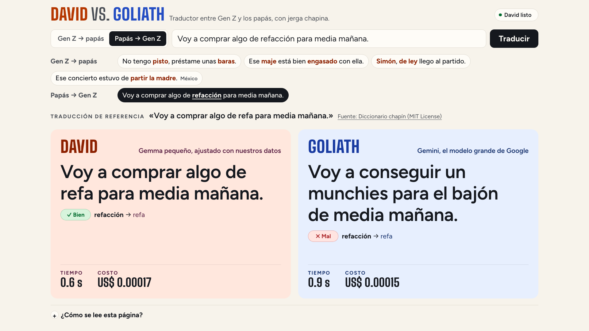

# Decisiones técnicas

Por qué Genlingo está hecho así: el resultado completo, el detalle de lo que enseña la demo, cada decisión técnica con lo descartado, la tabla del eval y el costo de cada ejecución de entrenamiento. Volver al [README](../README.md). [English version](DECISIONES.en.md).

## El resultado

El resultado es mixto, y la charla lo cuenta así:

- **Los datos con significado movieron la aguja.** El David de la ronda 3 (`genlingo-2026-10c-e2b-nomulti`) se entrenó con contrapartes validadas por significado, un prompt de léxico (cada término con su contraparte, términos cercanos y uno de otro país marcado «NO de aquí»), 1,715 pares sintéticos regenerados con esas contrapartes y 556 pares anclados en oraciones reales, con más Guatemala y Colombia. Produce jerga con el significado correcto en el **42 %** de las 399 frases de prueba, contra **34 %** del David de la ronda 2 (`genlingo-2026-10b-e2b`), y chrF++ sube de 56.6 a **59.7**. La ronda se decidió en un set de desarrollo aparte; el set de prueba solo confirmó.
- **La ronda 4 llevó la jerga Gen Z de México y del español neutro** (2026-10-06). El David de la página hoy es `genlingo-2026-10d-e2b`: los mismos datos más 1,600 pares anclados en jerga Gen Z de esos dos casos y 17 oraciones reales. En el eval del 2026-10-07 (en la nube) acierta el significado en el **44 %** de las frases de prueba contra **24 %** de Goliath (+19.5 [+13.5, +25.6]); el español neutro sube de 32 % a 43 %. Con jerga Gen Z general (cringe, random, crush…) David y Goliath empatan ([evals/report_probe.md](../evals/report_probe.md)): la ventaja de David es la jerga local.
- **David gana a Gemini en jerga correcta:** 42 % contra **26 %** (+16.3 puntos, IC 95 % [+10.8, +21.8]; 101 frases las acierta solo David y 36 solo Goliath). Gana en slang chapín (52 % contra 23 %), en papás → Gen Z de Guatemala y Colombia (44 % contra 20 %) y en Colombia; en México empatan. En *jerga resuelta*, que no mira el significado, empatan (82 % contra 77 %). En el eval respondió en **~0.7 s** (p50 670 ms, en una Mac); Goliath tardó **~2.6 s** y costó **$1.13 por 1,000 frases**. En la nube, David responde en **~0.5 s** ([David en la nube](#david-en-la-nube)).
- **Con el mismo glosario, Goliath empata en el set completo** (42 % contra 38 %), pero David sigue ganando en slang chapín (+17.4) y en papás → Gen Z (+16.0); en el español neutro (LATAM) gana Goliath (55 % contra 32 %). En cambios acertados quedan parejos (28 % David, 25 % Goliath, 29 % Goliath con glosario). La ventaja de David son **sus datos** (el banco de términos, las contrapartes y las oraciones reales, con fuentes y fecha) y haberse entrenado con ellos.
- **Comprimir no cuesta jerga:** el David de la página es el Q5_K_M (3.62 GB); con el David de la ronda 2, el Q5_K_M quedó a un punto del f16 (9.27 GB) con la misma latencia.
- **chrF++ casi no distingue a nadie:** devolver la frase sin traducir ya saca **53.2**; David 59.7, Goliath 53.5, Goliath con glosario 57.0. Por eso existen las métricas a nivel de término.
- **Reentrenar cada mes cuesta menos de $1, todo en la nube:** $0.97 de punta a punta (L4 para entrenar + CPU para fusionar y cuantizar).
- **Reentrenar con datos nuevos compra jerga:** el David de hace dos rondas de datos (`genlingo-2026-10-e2b-q5_k_m`) acertaba el 27 % de la jerga; el actual, el 42 %.

La historia completa, iteración por iteración (callejones sin salida incluidos), está en [BITACORA.md](BITACORA.md); los nichos donde David se mide contra Goliath, definidos antes de mirar resultados, en [evals/niche.md](../evals/niche.md).

> Las referencias del set de prueba se validan automáticamente contra el banco de términos (`auto_validated`); ninguna persona las revisó. Ningún par de prueba aparece en los datos de entrenamiento, ni siquiera dentro de una oración más larga. Las oraciones de prueba y los pares reales de entrenamiento vienen de la misma ronda de investigación (mitades disjuntas por hash), así que parte de la mejora puede ser cercanía a esas fuentes. Detalle completo en [evals/report.md](../evals/report.md).

## Qué vas a aprender, en detalle

| Lección | Dónde está en el código |
| --- | --- |
| **Datos propios con `origin`.** Cada par dice de dónde salió: `web` (URL + licencia), `synthetic` (modelo + versión de prompt + semilla) o `human` (evento). Sin eso no se puede confiar en la evaluación ni reentrenar cada mes. | `duel/genlingo_duel/dataset.py` (esquema `Pair` que valida la procedencia), [data/SOURCES.md](../data/SOURCES.md), [data/DATASHEET.md](../data/DATASHEET.md) |
| **Banco de términos, oraciones reales y pares sintéticos validados.** 532 términos de 92 fuentes y una tabla de contrapartes validadas por significado; Gemini genera pares de *sustitución de término* anclados en el banco, y cada par se valida contra el banco (término esperado presente, nada de jerga de otro país, la jerga del origen desaparece): el David de la página usa 1,715 más 1,600 de la ronda 4 (Gen Z de México y del español neutro). A eso se suman 565 pares anclados en oraciones reales de la web. Las oraciones citadas de fuentes con todos los derechos reservados viven en un bucket privado, no en el repo ([data/SOURCES.md](../data/SOURCES.md)). | `data/terms.jsonl`, `data/counterparts.jsonl`, `scripts/generate_pairs.py`, `duel/genlingo_duel/terms.py` |
| **LoRA en Cloud Run Jobs.** La misma imagen entrena en una L4 (TRL + PEFT, r=32, alpha=16 con rsLoRA, lr 2e-4, 3 épocas) y, en un job de CPU, fusiona, exporta GGUF con llama.cpp y publica un Modelfile para Ollama. Cada ejecución deja su duración y costo por etapa en un archivo. | `train/train_lora.py`, `train/finish.py`, `train/submit_job.py`, `infra/03-train-job.sh`, `train/runs/` |
| **El costo de comprimir.** f16 contra Q4_K_M, Q5_K_M, Q6_K, Q8_0 e imatrix: tamaño, latencia y cuánta jerga se pierde. | `train_lora.to_gguf`, `evals/quant_sweep.json`, [Cuantización: por qué Q5_K_M](#cuantización-por-qué-q5_k_m) |
| **Evals con métricas de término.** chrF++ más una línea base de «copiar la frase», *jerga correcta*, *jerga resuelta* y *cambios acertados* contra el banco; las decisiones de datos se toman en un set de desarrollo aparte y las derrotas de David se publican. Ningún modelo juzga a otro. | `evals/run_eval.py`, `evals/term_accuracy.py`, `evals/report.py` |
| **Reentrenamiento mensual.** Los modelos llevan la fecha de sus datos (`genlingo-AAAA-MM`, con una letra si hay dos versiones de datos en el mes: `genlingo-2026-10b-e2b` es la segunda ronda de investigación de octubre `genlingo-2026-10c-e2b-nomulti` la tercera, sin los pares de varios términos, y `genlingo-2026-10d-e2b` la cuarta); la página usa el de `DAVID_MODEL_TAG`. | `Makefile` (`TAG`), `.env.example` (`DAVID_MODEL_TAG`), `train/runs/` |
| **Comparación lado a lado.** Una página pública donde David y Goliath traducen la misma frase con su tiempo, y una revisión ✓/✗ por término en los ejemplos verificados. | `duel/genlingo_duel/static/index.html`, `duel/genlingo_duel/main.py`, `duel/genlingo_duel/translate_page.py`, `duel/genlingo_duel/term_check.py`, `data/translate_examples.json` |
| **Tu modelo en tu propia GPU.** David corre con Ollama en Cloud Run con una L4, con el modelo y los kernels de CUDA compilados dentro de la imagen; es privado (token de identidad) y escala a cero. La página lo despierta al abrirse y lo mantiene encendido mientras está abierta. | `david/Dockerfile`, `infra/04-david.sh`, `duel/genlingo_duel/cloud_auth.py`, `duel/genlingo_duel/main.py` |

## Decisiones

### David en la nube

Todo corre en Google Cloud (`ai-experiments-487722`); la laptop del escenario solo abre la página.

| Componente | Dónde | Por qué así |
| --- | --- | --- |
| **La página** (FastAPI + una página HTML) | Cloud Run, `us-central1`, pública, `min-instances=0` | Una URL que se abre en cualquier navegador, sin instalar nada. Sirve sus propias tipografías: nada se descarga de otro sitio. Su cuenta de servicio (`genlingo-page`) solo puede llamar a Vertex AI y a David. |
| **David** (Ollama con Gemma afinado y EmbeddingGemma) | Cloud Run con 1 NVIDIA L4, 4 vCPU y 16 GiB, `europe-west4`, privado, `min-instances=0`, `max-instances=1` | Es el modelo pequeño propio: un servidor que solo lo corre a él. `europe-west4` porque ahí el proyecto tiene cuota de L4 (la misma región del entrenamiento). El modelo, el de embeddings y los kernels de CUDA ya compilados van dentro de la imagen (`david/Dockerfile`), así que al encenderse no descarga ni compila nada. Atiende hasta 16 traducciones a la vez. Solo la página lo puede llamar (`roles/run.invoker`, token de identidad). |
| **Goliath** (Gemini) | Vertex AI, `GOOGLE_CLOUD_LOCATION=global`, razonamiento `low` | Como lo usaría cualquiera: sin el glosario de David. |

**Medido el 2026-10-06 y el 2026-10-07:**

- **Con la GPU encendida**, David responde en ~0.6 s a través de la página, glosario incluido (mediana 0.6 s y p95 0.8 s, una a la vez; [Tiempo y costo en la nube](../README.md#tiempo-y-costo-en-la-nube)). Goliath tardó una mediana de 3.2 s y hasta 13 s, y a veces Vertex AI respondió «429 resource exhausted»: la página reintenta hasta 3 veces con una espera corta y le da hasta 30 s.
- **Encender la GPU desde cero** y dejarlo rápido tarda **unos 35 segundos**: con la página y David apagados, `POST /api/david/wake` respondió «listo» a los 35 s (2026-10-07). Antes tardaba 214–224 s. Se midió dónde se iba el tiempo:
  - **Compilar los kernels de CUDA (la mayor parte).** Ollama trae sus kernels como PTX para la L4, y el driver los compilaba en cada arranque: 60 s el calentamiento del modelo, 22–28 s el de EmbeddingGemma, y de 3 a 9 s la primera frase de cada forma nueva (las frases lentas que se veían durante los primeros minutos). Ahora se compilan una vez en una L4 (`infra/07-david-jit-cache.sh`, 138 MB) y van dentro de la imagen (`CUDA_CACHE_PATH`): los dos calentamientos bajaron a 0.3 s y el p95 de una traducción, de 3.6 s a 0.8 s.
  - **Leer el modelo a pedazos.** Cloud Run baja la imagen a medida que se lee, y llama.cpp tocaba el GGUF por partes. `david/start.sh` lee las librerías de la GPU y los 4.2 GB de modelos de una vez, en paralelo, mientras Ollama arranca (16–18 s), y carga los dos modelos antes de la primera llamada.
  - **Lo que queda:** ~2 s para que Cloud Run arranque el contenedor, ~10 s de Ollama buscando la GPU, ~17 s leyendo los modelos y unos segundos de la página. La instancia queda lista 26–28 s después de arrancar.

  Por eso la página lo despierta al abrirse, muestra «Preparando a David…» con un reloj y lo mantiene encendido con una llamada por minuto mientras está abierta, visible y usada en los últimos 45 minutos.
- **Límites de gasto.** La página es pública y cada traducción cuesta: por conexión, hasta 60 traducciones y 12 despertares por minuto; para toda la página, hasta 1,500 llamadas a Gemini y 24 encendidos de David por día (`duel/genlingo_duel/limits.py`, `LIMIT_*` en `.env`). Al pasarse, responde 429 con un mensaje en español que la página muestra. Una charla queda muy por debajo. Los contadores viven en la memoria de cada instancia de la página (hasta 3), así que el techo real es el triple. reCAPTCHA o App Check no se agregaron: con estos topes, el gasto máximo de un día ronda $5 de Gemini y unas horas de GPU.
- **Costo:** la GPU cuesta unos **$1.05 por hora** mientras la instancia está encendida (L4 $0.0001867/s + 4 vCPU + 16 GiB, con CPU siempre asignada, que Cloud Run exige con GPU), y Cloud Run la apaga unos 15 minutos después de la última llamada. Una traducción de David ocupa ~0.5 s de esa GPU (~$0.00015), y una de Gemini costó entre $0.00015 y $0.0035 ese día; pero con el uso de una charla (decenas de frases) la hora encendida cuesta más que todo lo que cobra Gemini por las mismas frases. Con volumen se invierte: una GPU atiende decenas de miles de traducciones por hora. La página muestra el costo de cada traducción de los dos, y las proyecciones medidas (cuándo conviene cada uno) están en el README, [Tiempo y costo en la nube](../README.md#tiempo-y-costo-en-la-nube).

Descartado: dejar a David siempre encendido (`min-instances=1`) para que no haya espera. Son ~$750 al mes por una demo que se usa unas horas.

### Qué corre en la nube, además

- **Entrenamiento**: dos Cloud Run Jobs en `europe-west4` (L4 para entrenar, CPU para fusionar y convertir a GGUF); imagen construida con Cloud Build en Artifact Registry `charlas2027`.
- **Eval**: un Cloud Run Job con una L4 en `europe-west4` (`infra/06-eval-job.sh`, `evals/Dockerfile`). Corre Ollama dentro del job, carga cada modelo desde el bucket de modelos (montado de solo lectura) de uno en uno, lo precalienta con traducciones que no cuentan hasta que tres seguidas tardan menos de 1.5 s, y lo borra antes del siguiente (el disco del job vive en su memoria), llama a Gemini y deja el reporte en el bucket de staging; `make eval` lo copia a `evals/`.
- **Latencia en el eval de la nube:** en una prueba de 30 frases con el David de la página en el job, la mayoría tardó 0.2–0.3 s, pero 12 tardaron de 3 a 13 s, siempre las mismas frases en cada repetición. Por eso las latencias del README siguen siendo las del eval en la Mac (2026-10-04) y no hay un eval completo nuevo en la nube. La causa probable es la misma que tenía David al arrancar (kernels de CUDA que se compilan la primera vez que se usan, ver arriba): el job del eval no lleva los kernels compilados.
- **Bucket de modelos** (`ai-experiments-487722-genlingo-models`): un GGUF por David, con su Modelfile y `metrics.json`. De ahí salen la imagen de David y los modelos del eval.

### Por qué dos Cloud Run Jobs

Un reentrenamiento al mes no justifica nada encendido entre ejecuciones. Cloud Run Jobs es serverless, se cobra por segundo mientras la tarea corre y usa el mismo tipo de imagen que el resto. `make train` encadena dos jobs de la misma imagen (`infra/03-train-job.sh`):

| Job | Máquina | Qué hace |
| --- | --- | --- |
| `genlingo-train` | 1× L4, 8 vCPU, 32 GiB | Entrena el adaptador LoRA y lo guarda en el volumen del bucket (`ADAPTER_ONLY=1`). |
| `genlingo-finish` | solo CPU, 8 vCPU, 32 GiB, disco efímero de 10 GiB | Fusiona el adaptador, convierte a GGUF f16, cuantiza a `QUANT` (Q5_K_M) y publica en el bucket de modelos (`train/finish.py`). |

`train/submit_job.py` espera a los dos, calcula el costo de cada uno con las tarifas por segundo de GPU, vCPU y memoria, y deja el detalle por etapa y el total en `train/runs/<tag>.json`.

Por qué dividirlo: el sistema de archivos de Cloud Run vive en la memoria de la instancia. Entrenar, guardar un checkpoint fusionado de 10 GB y escribir un GGUF f16 de 9 GB no caben juntos en 32 GiB: la ejecución `genlingo-2026-10b-e2b` (`zct96`) murió por memoria al convertir a f16, y E4B ya había fallado igual al fusionar. En el job de CPU no queda nada del entrenamiento en memoria: los pesos base se copian del bucket con una lectura secuencial (cargarlos con `mmap` desde el bucket montado iba a ~5 MB/s), la fusión corre en un proceso hijo (devuelve sus ~10 GB al terminar), el checkpoint fusionado va al disco en memoria, el GGUF f16 va al disco efímero (respaldado en disco, no en memoria) y el checkpoint se borra antes de cuantizar. Además la GPU no se cobra mientras se fusiona y convierte. Los pesos base se cachean en un volumen de Cloud Storage que comparten los dos jobs; los GGUF no van ahí porque el convertidor escribe a saltos y sobre el bucket montado iba a ~3 MB/s (ejecuciones canceladas `kcwqz` y `kqlxv` en `train/runs/failed/`).

Descartado: Google Cloud Batch con una L4 y disco persistente. Resolvía la memoria en un solo paso, pero suma otra API, otra imagen de VM con drivers y otra cuenta de permisos, mientras que dos jobs reutilizan la imagen, la cuenta de servicio y el bucket que ya existían.

Alternativas disponibles: un Vertex AI Custom Job con el mismo contenedor y 200 GB de disco (`TRAIN_RUNTIME=vertex`, todo en un paso) y el notebook `train/genlingo.ipynb` para Colab. Al principio también se entrenó en la Mac (36.9 min para 1,000 pares en MPS; en la L4, la fase de entrenamiento de ese mismo tamaño tomó 5.8 min); ese camino se quitó el 2026-10-06, cuando todo pasó a la nube.

El ciclo de cada mes, de los datos a la página y de vuelta:

### E4B no cabía en el job de CPU

El checkpoint fusionado de E4B (16 GB) más el modelo en memoria no caben en los 32 GiB del job de CPU. El 2026-10-01 esa fusión se terminó en la Mac de 64 GB con el mismo `train/finish.py`; ese respaldo en la laptop se quitó el 2026-10-06. Si hiciera falta otra vez, `TRAIN_RUNTIME=vertex` corre entrenamiento y fusión en un solo Vertex AI Custom Job con 200 GB de disco. E4B no llegó a la página: con 67 % de jerga resuelta y p50 de 836 ms no supera al E2B f16.

### Cuantización: por qué Q5_K_M

Barrido del 2026-10-01 sobre las exportaciones de `genlingo-2026-10-e2b`, todas con el mismo prompt con glosario, en el set de prueba de ese día (319 pares). imatrix se calibró con pares de entrenamiento, nunca con el set de prueba. Corrió en la Mac con llama.cpp (el script, `train/quant_sweep.py`, se quitó el 2026-10-06 y está en el historial de git; el resumen quedó en `evals/quant_sweep.json`). Resultados por frase en `evals/results/20261001-152529.json` (fuera del repo); la tabla completa está en el historial de `evals/report.md` (commit `bb3f9fb`).

| Cuantización | imatrix | Tamaño | Jerga resuelta | Cambios acertados | chrF++ | p50 |
| --- | --- | --- | --- | --- | --- | --- |
| Q4_K_M | no | 3.42 GB | 67 % | 13 % | 51.2 | 496 ms |
| Q4_K_M | sí | 3.42 GB | 72 % | 14 % | 51.6 | 539 ms |
| **Q5_K_M** | no | 3.62 GB | **76 %** | 14 % | 51.5 | 587 ms |
| Q5_K_M | sí | 3.62 GB | 75 % | 15 % | 52.2 | 624 ms |
| Q6_K | no | 3.83 GB | 74 % | 15 % | 51.9 | 527 ms |
| Q8_0 | no | 4.95 GB | 75 % | 14 % | 51.9 | 532 ms |
| f16 | — | 9.27 GB | 75 % | 15 % | 51.9 | 534 ms |

La regla (la misma de `evals/report.py`): el archivo más pequeño a ≤ 2 puntos del f16 en jerga resuelta, con p50 < 1 s. Q4_K_M pierde 8 puntos contra el f16; imatrix recupera 5 (72 %), pero sigue 3 por debajo. Q5_K_M es el más pequeño que no pierde jerga, con 0.2 GB más que Q4_K_M; Q6_K y Q8_0 pesan más sin mejorar. Por eso `.env` fija `QUANT=Q5_K_M` para `make train` y el David de la página es Q5_K_M. El eval del 2026-10-04 (399 frases) repite el resultado: Q4_K_M 67 %, Q5_K_M 74 % y f16 74 % con `genlingo-2026-10-e2b`; Q5_K_M 82 % y f16 81 % con `genlingo-2026-10b-e2b`.

### El prompt con glosario

El prompt con país empieza por el país («Variante: español de Guatemala. Usa solo expresiones de Guatemala…») porque «chido» y «chilero» son la misma palabra en lugares distintos. Al final lleva un glosario del banco de términos, del país o neutro. El David de la página usa el estilo `lexicon` (léxico): seis entradas, cada término de la generación de origen que aparece en la frase con su contraparte validada por significado (`data/counterparts.jsonl`; sin contraparte, su significado), los términos de la otra generación más cercanos según EmbeddingGemma y uno de otro país marcado «NO de aquí». Los Davids de rondas anteriores usan el estilo `glossary`: cuatro entradas sin contrapartes, primero los términos que aparecen literalmente en la frase y después los más cercanos. El tiempo de recuperación se suma a la latencia de David.

David se entrena con exactamente ese formato (`make train-data` usa el estilo `lexicon` por defecto) y la página lee de `train/runs/<tag>.json` con qué prompt se entrenó cada David: no hay diferencia entre entrenamiento y la página. Goliath recibe el prompt con país, sin glosario, por defecto (`GOLIATH_PROMPT_STYLE`), porque el banco es dato de David; `make eval` corre además a Goliath con el mismo glosario, y así se ve cuánto del resultado es modelo y cuánto es dato.

### El set de prueba es solo web, nunca sintético

Una referencia escrita por Gemini premiaría a Goliath por sonar como él mismo. Los pares de prueba salen de oraciones reales encontradas en la web (dos rondas de investigación, 522 candidatos); la referencia la escribe el curador a partir del significado que da la fuente, y `scripts/validate_test_set.py` la valida contra el banco de términos sin intervención humana: quedan 399 `auto_validated`. También rechaza cualquier par de prueba que aparezca en un archivo de entrenamiento (sintéticos, reales o del público), aunque sea dentro de una oración más larga: coincidencia de subcadenas cruda y normalizada (`duel/genlingo_duel/overlap.py`). La segunda ronda se parte por un hash estable del id: la mitad va a prueba y la otra mitad a pares de entrenamiento anclados en oraciones reales (`make real-pairs`), sin oraciones compartidas. El esquema `Pair` rechaza cualquier par sintético en el split de prueba. El esquema admite pares `origin=human` (los mandaba la app del público de una versión anterior de la demo, que ya no existe; no quedó ninguno en los datos): se repartirían 80/20 entre entrenamiento y prueba con un hash estable del id.

### EmbeddingGemma: dónde se usa y por qué sigue la versión 1

**Dónde se usa:** solo para el léxico del prompt de David. Por cada frase, EmbeddingGemma convierte la frase y cada jerga del banco en vectores y escoge las jergas más cercanas; esas van en el prompt de David como pistas (`duel/genlingo_duel/glossary.py`, `lex_entries`). Las jergas que aparecen tal cual en la frase se buscan por texto, sin embeddings. Corre en el mismo servicio de David, en la nube; nada corre en la laptop. Goliath no lo usa.

**Por qué sigue la versión 1** (`embeddinggemma`, 300M):

- **Funciona mejor.** En Tzij, el otro demo de la charla, EmbeddingGemma 2 dio peores traducciones que la versión 1 en la misma tarea de recuperación: 38.8 contra 39.9 de chrF++ en desarrollo y 23.9 contra 25.8 en traducción general.
- **En Genlingo no se puede usar todavía.** Se probó el 2026-10-07 con el mismo eval de desarrollo: Ollama 0.35 (el de David) no conoce su arquitectura (`unknown model architecture: 'gemma-embedding2'`), y Ollama 0.40, el primero que lo trae (`embeddinggemma-2:270m` a `:740m`), solo lo corre en Apple Silicon (MLX); en la GPU de Cloud Run falla (`MLX not available`).
- **David se entrenó con el léxico de la versión 1.** Cambiar el modelo cambia lo que David recibe, así que solo se cambiaría si un eval lo mostrara igual o mejor. Referencia en desarrollo con la versión 1 (146 pares, 2026-10-07): jerga correcta 33 %, jerga resuelta 85 %, chrF++ 63.3.

### Tarifas de Gemini con fecha

Los precios cambian, y eso es parte de la historia. `GEMINI_PRICE_SCHEDULE=2026-09-30:0.75/3.75,2027-01-01:1.50/7.50` es una lista de tarifas por fecha: cada traducción y cada eval usan la tarifa vigente ese día y registran cuál usaron. El reporte muestra además lo que costaría el mismo eval con la tarifa de 2027 ($2.26 por 1,000 frases en vez de $1.13). Los tokens de razonamiento se cobran como salida. La página muestra el costo de cada traducción: el de Gemini con la tarifa del día y el de David como los segundos de GPU que usó ([David en la nube](#david-en-la-nube)). Las exportaciones de una misma ejecución (`-f16`, `-q5_k_m`) comparten su `train/runs/<tag>.json`.

### Cómo compara la página

- **Temperatura 0 en los dos lados**, como en `make eval`: la página muestra lo que midió el eval y la misma frase recibe siempre la misma respuesta. A temperatura 0.2, en una prueba David cambió «chafa» por «muy regular» (mal).
- **Lado a lado, sin ganador.** Los dos reciben la misma frase al mismo tiempo (`POST /api/translate/david` y `/api/translate/goliath`); cada columna se llena cuando responde y muestra su tiempo y su costo. No hay rondas, marcador ni votos. Goliath recibe el prompt con país, sin el glosario de David, como lo usaría cualquiera.
- **La revisión término por término** (`duel/genlingo_duel/term_check.py`) usa las reglas de la *jerga correcta* del eval, un término a la vez. Gen Z → papás: el término Gen Z desapareció y su significado (o su contraparte, o la palabra que usó la referencia humana) está en la traducción. Papás → Gen Z: el término de los papás se cambió por su contraparte Gen Z validada o un equivalente. Se aplica a cualquier frase: en los ejemplos también cuenta la palabra que usó la referencia humana; en una frase escrita, solo el banco. Si la frase escrita no tiene jerga que el banco conozca, la página lo dice en vez de calificar.
- **Los ejemplos** (`data/translate_examples.json`) son frases chapinas del set de prueba. Se probaron en vivo las 51 que la revisión puede juzgar, 3 veces con cada modelo; quedaron las que David tradujo bien y Goliath mal las 3 veces y donde una persona ve lo mismo que la revisión. Con David ya en la nube se probaron otras 3 veces: 12 de 12 para David, 0 para Goliath. `make check` las vuelve a traducir con los dos en la página en vivo.
- **David despierta solo.** `POST /api/david/wake` enciende la instancia de David (la primera llamada espera a que arranque), carga los dos modelos y responde cuando están listos; `GET /api/status` da el estado y los segundos que lleva, para el reloj de la página.

## Resultados

Eval del 2026-10-04 sobre 399 pares de prueba web `auto_validated` (de 522 candidatos; 123 rechazados por la validación automática, 4 de ellos por aparecer dentro de un par de entrenamiento). Todos los modelos de Ollama con el prompt con que se entrenaron, uno a la vez en una M1 Max (el eval corre ahora en un Cloud Run Job con una L4: `make eval`); Goliath con temperatura 0 (2 errores con glosario). *Jerga correcta* (enmienda 1 de [evals/niche.md](../evals/niche.md)): el término producido significa lo mismo, según la tabla de contrapartes validada por significado.

| Variante | Jerga correcta | Jerga resuelta | Gen Z → papás | papás → Gen Z | Cambios acertados | chrF++ | p50 | Costo / 1,000 frases (eval) | Tamaño |
| --- | --- | --- | --- | --- | --- | --- | --- | --- | --- |
| Copiar la frase (línea base) | 1 % | 1 % | 0 % | 3 % | 0 % | 53.2 | — | — | — |
| `gemma4:e2b-it-qat` (base) | 14 % | 58 % | 95 % | 10 % | 14 % | 50.2 | 364 ms | $0 | 4.34 GB |
| `gemma4:e2b-it-qat` + glosario | 38 % | 62 % | 94 % | 20 % | 23 % | 55.0 | 452 ms | $0 | 4.34 GB |
| `gemma4:e4b` (base) | 19 % | 68 % | 97 % | 31 % | 17 % | 48.2 | 802 ms | $0 | 6.58 GB |
| `genlingo-2026-09` (Q4, prompt básico) | 18 % | 62 % | 94 % | 20 % | 14 % | 55.0 | 391 ms | $0 | 3.42 GB |
| `genlingo-2026-10-e2b` + glosario (Q4) | 25 % | 67 % | 95 % | 31 % | 16 % | 55.7 | 512 ms | $0 | 3.42 GB |
| `genlingo-2026-10-e2b-q5_k_m` + glosario (David anterior) | 27 % | 74 % | 97 % | 43 % | 18 % | 55.4 | 564 ms | $0 | 3.62 GB |
| `genlingo-2026-10-e2b-f16` + glosario | 28 % | 74 % | 99 % | 42 % | 19 % | 56.3 | 566 ms | $0 | 9.27 GB |
| `genlingo-2026-10b-e2b` + glosario (Q5_K_M, ronda 2) | 34 % | 82 % | 99 % | 59 % | 22 % | 56.6 | 557 ms | $0 | 3.62 GB |
| `genlingo-2026-10b-e2b-f16` + glosario | 34 % | 81 % | 98 % | 59 % | 22 % | 56.7 | 543 ms | $0 | 9.27 GB |
| `genlingo-2026-10c-e2b-nomulti` + léxico (Q5_K_M, ronda 3) | 42 % | 82 % | 100 % | 58 % | 28 % | 59.7 | 670 ms | $0 | 3.62 GB |
| **`genlingo-2026-10d-e2b` + léxico (Q5_K_M, en la página; eval del 2026-10-07 en la nube)** | **44 %** | **80 %** | 100 % | 54 % | 28 % | **60.0** | 237 ms | **$0** | 3.62 GB |
| Goliath `gemini-3.8-flash` | 26 % | 77 % | 97 % | 51 % | 25 % | 53.5 | 2.60 s | $1.13 | — |
| Goliath + el mismo glosario | 38 % | 82 % | 100 % | 58 % | 29 % | 57.0 | 3.05 s | $1.27 | — |

**Lectura de los resultados** (eval del 2026-10-04, ronda 3; el de la ronda 4 está en [evals/report.md](../evals/report.md)). Frase por frase, David produce la jerga correcta y Goliath no en 101 frases; al revés, en 36. Contra Goliath con glosario la cuenta se acerca (79 contra 63) y el set completo queda en empate; David sigue ganando en slang chapín y en papás → Gen Z, y Goliath gana en el español neutro (LATAM). En *jerga resuelta* (que cambió el registro, sin mirar el significado) David y Goliath empatan, y David todavía mete jerga de otro país en 16 de 173 frases papás → Gen Z (Goliath: 3). El salto de esta ronda está en el significado: el David de la ronda 2 ya resolvía el 82 %, pero acertaba el término en el 34 %. David gana en velocidad y gana en jerga correcta mientras el banco de términos, las contrapartes y las oraciones reales sean solo suyos. chrF++ queda cerca de la línea base de copiar (53.2) porque una reescritura de registro conserva casi todas las palabras: no sirve para decidir quién tradujo la jerga. Los IC por nicho están en [evals/niche_report.md](../evals/niche_report.md).

Las diez peores derrotas de David (entre las frases de fuentes abiertas) y los cortes por país y dirección están en [evals/report.md](../evals/report.md). La primera versión de los datos (paráfrasis libre) dejó a David *por debajo* de la base (chrF++ 39.1): está documentado en [evals/experiments/2026-09-parafrasis-libres.md](../evals/experiments/2026-09-parafrasis-libres.md).

David dice «refa», como lo dice Gen Z en Guatemala, y acierta el término; Goliath escribe «munchies para el bajón» y no.

## Costo de entrenamiento por ejecución

Cloud Run Jobs en `europe-west4`: entrenamiento en 1× NVIDIA L4 sin redundancia zonal, 8 vCPU, 32 GiB; desde `genlingo-2026-10b-e2b`, fusión + GGUF en un job aparte de CPU (8 vCPU, 32 GiB). Costo = segundos facturados × tarifas por segundo (`CLOUD_RUN_*_USD_PER_S` en `.env`), por etapa.

| Ejecución | Base | Pares | Resultado | Duración | Costo |
| --- | --- | --- | --- | --- | --- |
| `genlingo-2026-09` | E2B | 1,000 (edición mínima) | listo (loss 2.33 → 0.14) | 17.4 min | $0.41 |
| `genlingo-2026-10-e2b` | E2B | 1,500 (anclados en el banco) | listo (loss 2.26 → 0.12) | 28.2 min | $0.67 |
| `genlingo-2026-10-e4b` | E4B | 1,500 (anclados en el banco) | entrenó; sin memoria al fusionar → fusión terminada en la Mac | 41.3 min | $0.98 |
| `genlingo-2026-10b-e2b` | E2B | 1,709 (1,375 sintéticos + 334 anclados en oraciones reales) | listo en la nube, dos jobs (loss 2.62 → 0.16): entrenamiento 25.3 min $0.60 + fusión/GGUF Q5_K_M y f16 9.0 min $0.11 | 34.3 min | $0.71 |
| `genlingo-2026-10c-e2b` | E2B | 2,972 (2,416 sintéticos, 701 de ellos de 2–3 términos, + 556 anclados en oraciones reales) | listo (loss 2.19 → 0.04): entrenamiento 54.0 min $1.28 + fusión/GGUF 10.3 min $0.13; quedó fuera por latencia (p50 1.99 s en dev) | 64.2 min | $1.41 |
| `genlingo-2026-10c-e2b-nomulti` | E2B | 2,271 (1,715 sintéticos + 556 anclados en oraciones reales) | listo, ronda 3 (loss 1.97 → 0.06): entrenamiento 35.7 min $0.85 + fusión/GGUF 10.2 min $0.13 | 45.9 min | $0.97 |
| `genlingo-2026-10d-e2b` | E2B | 3,880 (3,315 sintéticos, 1,600 de ellos de Gen Z de México y del español neutro, + 565 anclados en oraciones reales) | listo, **en la página**: entrenamiento y fusión/GGUF en dos jobs | 67.5 min | $1.49 |
| `genlingo-2026-10c-e2b-nomulti-orpo` | E2B | 264 pares de preferencia sobre el adaptador de nomulti | listo: muestreo + ORPO 18.4 min $0.44 + fusión/GGUF 9.9 min $0.12; fuera (bajó la jerga papás → Gen Z en dev) | 28.3 min | $0.56 |
| `failed/genlingo-2026-10b-e2b-zct96` | E2B | 1,709 | entrenó; muerta por memoria al convertir a GGUF f16 en el job único → motivó la división en dos jobs | 26.8 min | $0.63 |
| `failed/genlingo-2026-10c-e2b-nomulti-orpo-8995k` | E2B | 2,271 | límite de tiempo: el modelo se cargaba en la CPU para muestrear | 60.4 min | $1.43 |
| `failed/genlingo-2026-10c-e2b-nomulti-orpo-jwt8d` | E2B | 2,271 | sin memoria en la L4: con lote 4 los logits de Gemma no cabían (ahora lote 1 × 16) | 16.2 min | $0.38 |
| `failed/genlingo-2026-09-nv5r5` | E2B | 1,000 | falló al arrancar (faltaba `gcc` para Triton) | 10.9 min | $0.26 |
| `failed/genlingo-2026-09-kcwqz` | E2B | 1,000 | cancelada: GGUF escrito en el bucket montado, demasiado lento | 31.2 min | $0.74 |
| `failed/genlingo-2026-09-kqlxv` | E2B | 1,000 | cancelada a ~28 min (misma causa, al leer) | — | sin registro |
| `experiments/genlingo-2026-09-parafrasis` | E2B | 1,000 (paráfrasis libre) | laptop, MPS | 36.9 min | $0 |

Generar 1,500 pares sintéticos con Gemini cuesta menos de $1 ($0.71 y unos 10 min en la ronda 3, `data/pairs/synthetic.meta.json`). Un reentrenamiento mensual de E2B, de punta a punta en la nube (entrenamiento → GGUF), cuesta menos de $1. Servir a David cuesta lo que está encendida su GPU (~$1.05 por hora, [David en la nube](#david-en-la-nube)).
