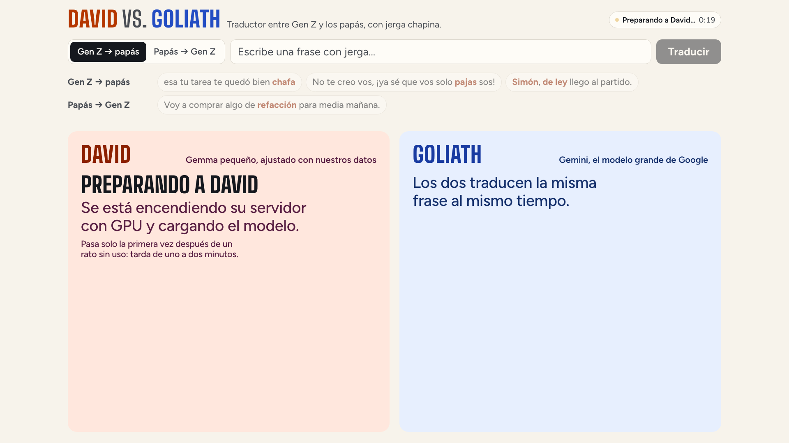

# Demo script

The demo is a single page in the cloud: David and Goliath translate the same phrase at the same time, side by
side, between Gen Z slang and parents' Spanish. Each column shows its translation and how long it took. About
4 minutes. [Versión en español](DEMO.md). The page and the talk are in Spanish.

## Before the talk

Open this page in Chrome **about ten minutes before** and leave it open:

**https://genlingo-611681112050.us-central1.run.app**

The top right says «Preparando a David…» with a clock: his GPU server is starting (it shuts down on its own when
nobody uses it). It takes about four minutes. Once it says «David listo» he's ready, and the page keeps him on
while it stays open. Go full screen (`⌃⌘F`) and check from the back of the room that it reads.

## On stage

### 1 · The page (30 s)

What you see: the direction, the text box and the examples at the top; two columns below, David on the left and
Goliath on the right.

> On the left, David: a small model, tuned with our data, on a server of his own. On the right, Goliath:
> Gemini, Google's big model. Both will translate the same phrase at the same time.

### 2 · Gen Z to parents (1 min 30 s)

Tap the three «Gen Z → papás» examples, one by one. The human reference translation appears at the top, with its
source. Under each column, each slang term with ✓ or ✗.

| Example | David | Goliath |
| --- | --- | --- |
| esa tu tarea te quedó bien **chafa** | Esa tarea tuya te quedó muy mala | Esa tu tarea te quedó pura lata |
| No te creo vos, ¡ya sé que vos solo **pajas** sos! | No te creo vos, ¡ya sé que vos solo mentís! | No te creo vos, ¡si ya sé que pura casaca sos! |
| **Simón, de ley** llego al partido. | Sí, seguro llego al partido. | Cabal, sin falta llego al partido. |

Goliath's wording varies a little from one run to the next; in every test it swapped the slang for more slang
instead of saying it the way a parent would.

> «Chafa», «pajas», «simón, de ley»: David knows what they mean and says it the way your mom would. Goliath
> swaps slang for more slang. And look at the time: David answers in half a second.

### 3 · Parents to Gen Z (1 min)

Tap the «Papás → Gen Z» example.

| Example | David | Goliath |
| --- | --- | --- |
| Voy a comprar algo de **refacción** para media mañana. | Voy a comprar algo de refa para media mañana. | Voy a conseguir un munchies para el bajón de media mañana. |

> The hard direction: you have to produce the right local slang. David says «refa», as they say in Guatemala;
> Goliath makes up «munchies».

### 4 · A typed phrase (30 s, optional)

Type a phrase with Guatemalan slang in the box and press **Traducir**. For typed phrases the page shows both
translations and the time, without the per-term check.

> Any phrase, live.

A typed phrase isn't verified beforehand: either one can get it wrong.

## Where the examples come from

The four examples are in `data/translate_examples.json`, with their source, license, why they're there and the
live runs with both models. They're Guatemalan slang phrases from the test set: David never saw them in
training. The 51 short Guatemalan phrases the term-by-term check can judge were run 3 times with each model, and
the ones David got right and Goliath got wrong all 3 times were kept. After moving David to the cloud they were
run 3 more times each against the Cloud Run David: David got all 12 right and Goliath none. They're from
Guatemala because that's where David gets more slang right than Gemini (52 % vs 23 %,
[evals/niche_report.md](../evals/niche_report.md)).

## If something fails

| Symptom | What to do |
| --- | --- |
| Still «Preparando a David…» after 5 minutes | Reload the page: it asks him to start again. |
| The top says «David no respondió · reintentando» | The page retries on its own every few seconds; wait for «David listo». |
| David's column says «No respondió» | Press **Traducir** again. |
| Goliath takes long | Gemini is slow; David's column already answered. Move on to the next example. |
| Goliath gets an example right | It didn't happen in any test, but Goliath varies. Move on to another example. |
