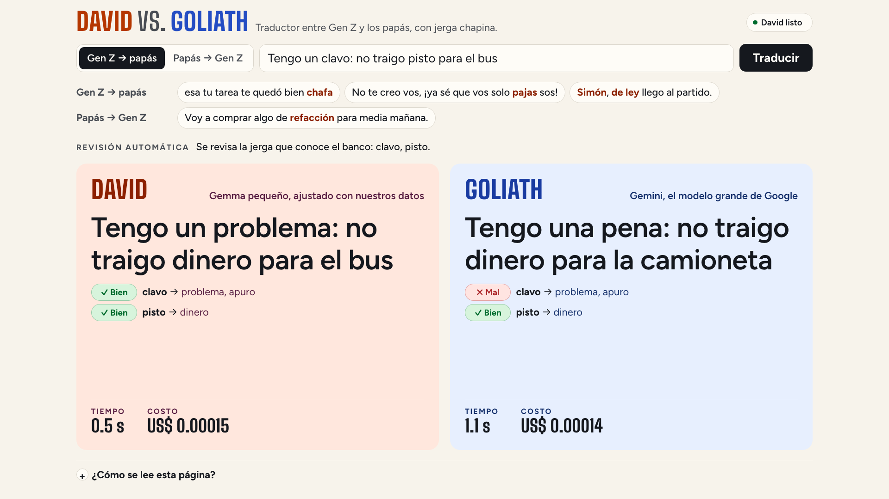

# Demo script

The demo is a single page in the cloud: David and Goliath translate the same phrase at the same time, side by
side, between Gen Z slang and parents' Spanish. Each column shows its translation, how long it took and what it
cost, and under it, each slang word with ✓ or ✗. About 4 minutes. [Versión en español](DEMO.md). The page and the talk are in Spanish.

## Before the talk

Open this page in Chrome **a few minutes before** and leave it open:

**https://genlingo-611681112050.us-central1.run.app**


The top right says «Preparando a David…» with a clock: his GPU server is starting (it shuts down on its own when
nobody uses it). It takes under a minute (about 35 seconds). Once it says «David listo» he's ready, and the page keeps him on
while it stays open. Go full screen (`⌃⌘F`) and check from the back of the room that it reads.

## On stage

### 1 · The page (30 s)

What you see: the direction, the text box and the examples at the top; two columns below, David on the left and
Goliath on the right. At the bottom, «¿Cómo se lee esta página?» explains ✓/✗, time and cost in a line each.

> On the left, David: a small model, tuned with our data, on a server of his own. On the right, Goliath:
> Gemini, Google's big model. Both will translate the same phrase at the same time.

### 2 · Gen Z to parents (1 min 30 s)


Tap the two «Gen Z → papás» examples, one by one. The human reference translation appears at the top, with its
source. Under each column, each slang term with ✓ or ✗.

| Example | David | Goliath |
| --- | --- | --- |
| esa tu tarea te quedó bien **chafa** | esa tu tarea te quedó bien mal hecha | Esa tu tarea te quedó pura lata. |
| **Simón, de ley** llego al partido. | Sí, seguro llego al partido. | Cabal, fijo llego al partido. |

Goliath's wording varies a little from one run to the next; in every test it swapped the slang for more slang
instead of saying it the way a parent would.

> «Chafa», «simón, de ley»: David knows what they mean and says it the way your mom would. Goliath
> swaps slang for more slang. And look at the time: David answers in half a second; Goliath, in several.

Each column's cost is what that translation cost: Gemini bills by token; David, by his GPU's seconds. A single
phrase may come out cheaper on either side; David's savings show up with volume (the projections are in the
README). What the talk says about cost is just that: «at volume, David costs a fraction».

### 3 · Parents to Gen Z (1 min)


Tap the «Papás → Gen Z» example.

| Example | David | Goliath |
| --- | --- | --- |
| Voy a comprar algo de **refacción** para media mañana. | Voy a comprar algo de refa para media mañana. | Voy a conseguir un moncheo para el bajón de media mañana. |

> The hard direction: you have to produce the right local slang. David says «refa», as they say in Guatemala;
> Goliath makes up «munchies».

### 4 · A typed phrase (30 s, optional)



Type a phrase with Guatemalan slang in the box and press **Traducir**, for example:

```
Tengo un clavo: no traigo pisto para el bus
```

The top line says which slang in the phrase the bank knows («clavo», «pisto»), and each column marks it with ✓ or
✗, just like the examples. If the phrase has no slang the bank knows, the page says so: there's nothing to check
automatically.

> Any phrase, live.

A typed phrase isn't checked in advance: either side can get it wrong.

## Where the examples come from

The three examples are in `data/translate_examples.json`, with their source, license, why they're there and the
live runs with both models. They're Guatemalan slang phrases from the test set (David never saw them in
training), from openly licensed sources (WikiLengua and diccionario-chapin): sentences from all-rights-reserved
sources can't be shown. Each was run 3 times against the cloud David (`genlingo-2026-10d-e2b`) and Gemini: David
got all 9 right and Goliath none. They're from Guatemala because that's where David gets more slang right than
Gemini (50 % vs 20 %, [evals/niche_report.md](../evals/niche_report.md)). The 38 open-source test phrases from
Mexico, Colombia and neutral Spanish were also tried: none passed every check (in Colombia and neutral Spanish
Goliath did as well or better; in Mexico David won by eye in 3, but the page's ✓/✗ check can't tell). With
general Gen Z slang («cringe», «random», «crush») both get it right about equally: if someone types it live,
expect a tie.

## If something fails

| Symptom | What to do |
| --- | --- |
| Still «Preparando a David…» after 2 minutes | Reload the page: it asks him to start again. |
| The top says «David no respondió · reintentando» | The page retries on its own every few seconds; wait for «David listo». |
| David's column says «No respondió» | Press **Traducir** again. |
| Goliath takes long | Gemini is slow; David's column already answered. Move on to the next example. |
| Goliath gets an example right | It didn't happen in any test, but Goliath varies. Move on to another example. |
