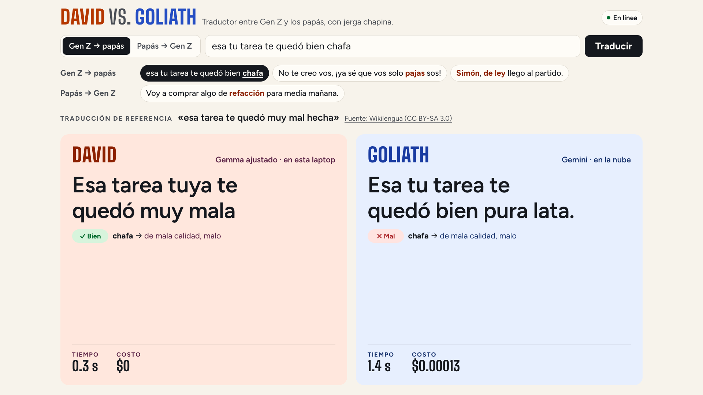

# Guion de la demo

La demo es una sola página: David (en la laptop) y Goliath (en la nube) traducen la misma frase al mismo
tiempo, lado a lado, entre la jerga de Gen Z y el español de los papás. Cada columna muestra su traducción,
cuánto tardó y cuánto costó. Unos 4 minutos. [English version](DEMO.en.md).

## Antes de la charla

Una hora antes, en la laptop del escenario (cargada):

- [ ] `make up` en una terminal. Arranca Ollama, carga a David y el modelo del glosario, levanta el servicio y
      abre la página `http://127.0.0.1:8787/traducir`.
- [ ] En otra terminal:

      ```bash
      make stage-on && make warmup && make preflight
      ```

      `preflight` revisa los modelos y la página, y traduce en vivo cada ejemplo con los dos: David tiene que
      acertar la jerga y Goliath no. Tiene que terminar en «preflight ok»; cada `[FALLA]` dice cómo arreglarlo.
- [ ] Chrome a pantalla completa con la página. Comprueba desde el fondo de la sala que se lea.
- [ ] Toca un ejemplo una vez, para que la primera traducción en escena no sea la más lenta.
- [ ] Prueba sin Wi-Fi: apágalo, espera «Sin internet · David sigue» arriba a la derecha, toca un ejemplo y
      comprueba que David traduce y Goliath dice «Sin conexión». Vuelve a encenderlo y espera «En línea».

Después de la charla: `make stage-off`.

## En escena

### 1 · La página (30 s)

Qué se ve: arriba la dirección, el cuadro de texto y los ejemplos; abajo, dos columnas, David a la izquierda y
Goliath a la derecha.

> A la izquierda, David: un modelo pequeño que corre en esta laptop, sin internet. A la derecha, Goliath:
> Gemini, en la nube. Los dos van a traducir la misma frase al mismo tiempo.

### 2 · De Gen Z a papás (1 min 30 s)



Toca los tres ejemplos de «Gen Z → papás», uno por uno. Arriba aparece la traducción de referencia, hecha por
personas, con su fuente. Debajo de cada columna, cada término de jerga con ✓ o ✗.

| Ejemplo | David | Goliath |
| --- | --- | --- |
| esa tu tarea te quedó bien **chafa** | Esa tarea tuya te quedó muy mala | Esa tu tarea te quedó bien pura lata |
| No te creo vos, ¡ya sé que vos solo **pajas** sos! | No te creo vos, ¡ya sé que vos solo mentís! | No te creo vos, ¡ya sé que sos pura casaca! |
| **Simón, de ley** llego al partido. | Sí, seguro llego al partido. | Cabal, fijo llego al partido. |

Lo que dice Goliath varía un poco de una vez a otra; en las pruebas en vivo, cada vez cambió la jerga por otra
jerga en vez de decirlo como un papá.

> «Chafa», «pajas», «simón, de ley»: David sabe qué significan y lo dice como lo diría tu mamá. Goliath cambia
> la jerga por más jerga. Y miren el tiempo y el costo: David, menos de un segundo y cero dólares.

### 3 · De papás a Gen Z (1 min)


Toca el ejemplo de «Papás → Gen Z».

| Ejemplo | David | Goliath |
| --- | --- | --- |
| Voy a comprar algo de **refacción** para media mañana. | Voy a comprar algo de refa para media mañana. | Voy a conseguir un munchies para el bajón de media mañana. |

> La dirección difícil: hay que poner la jerga correcta de aquí. David dice «refa», como se dice en Guatemala;
> Goliath inventa «munchies».

### 4 · Sin internet (45 s)


Apaga el Wi-Fi de la laptop, espera «Sin internet · David sigue» y toca un ejemplo.

> Sin red, Goliath no existe. David sigue igual: el modelo, el glosario y la página viven en esta laptop.

Vuelve a encender el Wi-Fi.

### 5 · Una frase escrita (30 s, opcional)

Escribe en el cuadro una frase con jerga chapina y pulsa **Traducir**. En las frases escritas la página muestra
las dos traducciones, el tiempo y el costo, sin la revisión por término.

> Cualquier frase, en vivo.

Una frase escrita no está verificada de antemano: cualquiera de los dos puede equivocarse.

## De dónde salen los ejemplos

Los cuatro ejemplos están en `data/translate_examples.json`, con su fuente, su licencia, la razón por la que
están y las 3 pruebas en vivo con los dos modelos. Son frases de jerga chapina del set de prueba: David nunca
las vio al entrenar. Se probaron las 51 frases chapinas cortas que la revisión término por término puede
juzgar, 3 veces con cada modelo, y quedaron las que David tradujo bien y Goliath mal las 3 veces, donde una
persona ve lo mismo que la revisión. Se eligieron de Guatemala porque ahí David acierta más jerga que Gemini
(52 % contra 23 %, [evals/niche_report.md](../evals/niche_report.md)).

## Si algo falla

| Síntoma | Qué hacer |
| --- | --- |
| La página no abre | `make up` en una terminal; la página está en `http://127.0.0.1:8787/traducir`. |
| Arriba dice «El servicio no responde» | El servicio se cayó: `Ctrl+C` en la terminal de `make up` y `make up` otra vez. |
| La columna de David dice «No respondió» | Ollama no corre o no tiene a David: `ollama ps` y `make up` otra vez. |
| Goliath dice «Sin conexión» con Wi-Fi | La red del lugar bloquea Vertex AI. Úsalo como el momento sin internet. |
| Goliath tarda mucho | La red está lenta; la columna de David ya respondió. Sigue con el siguiente ejemplo. |
| En un ejemplo Goliath acierta | Pasa poco (no pasó en las pruebas), pero Goliath varía. Sigue con otro ejemplo. |
