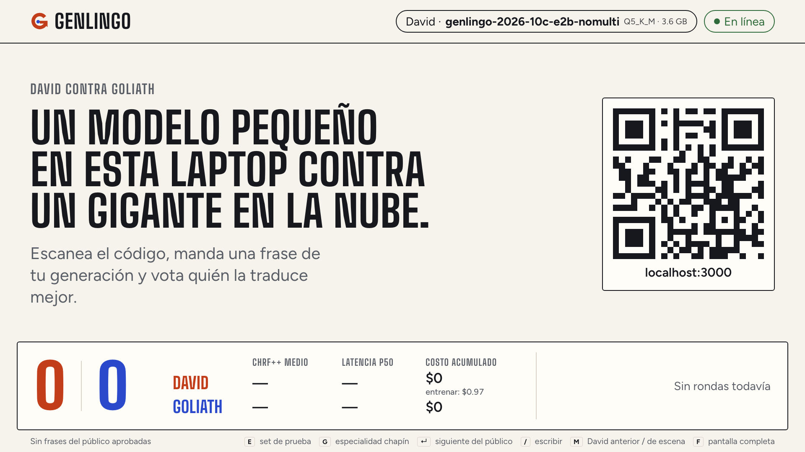
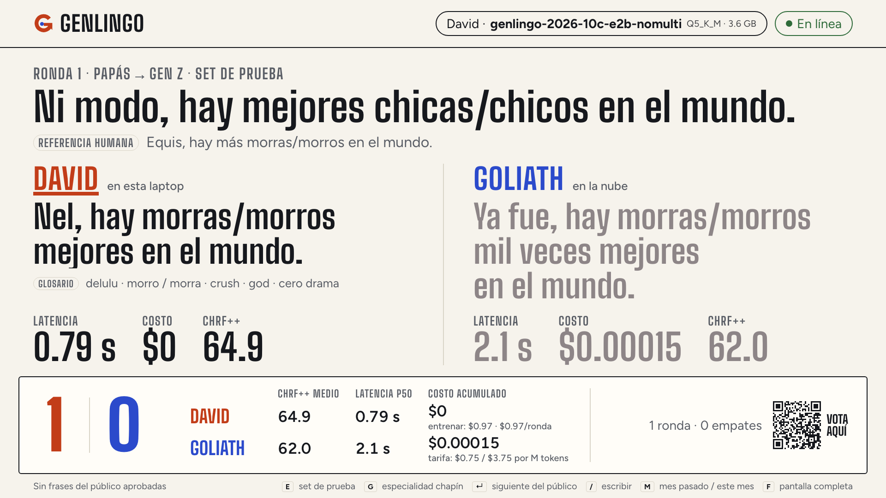
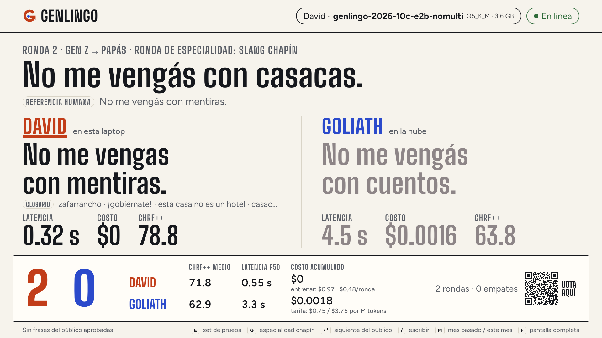
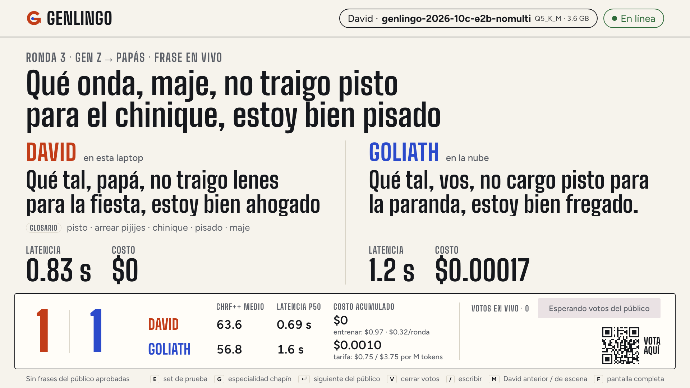
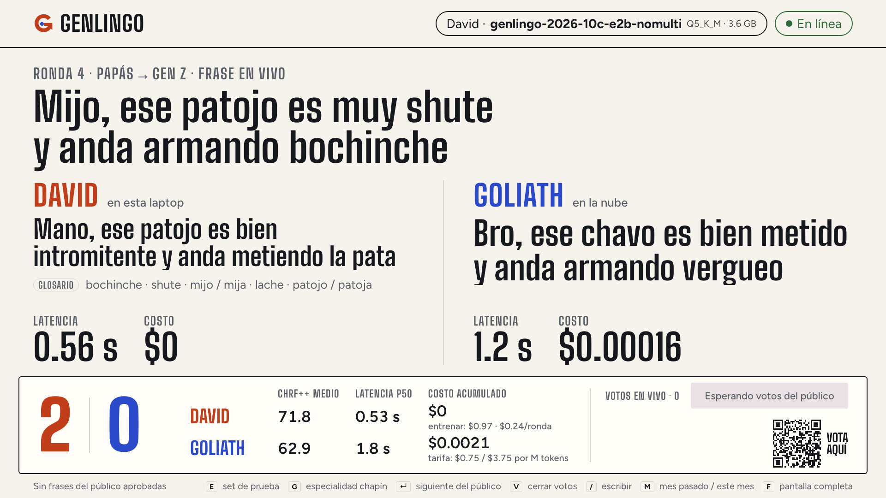
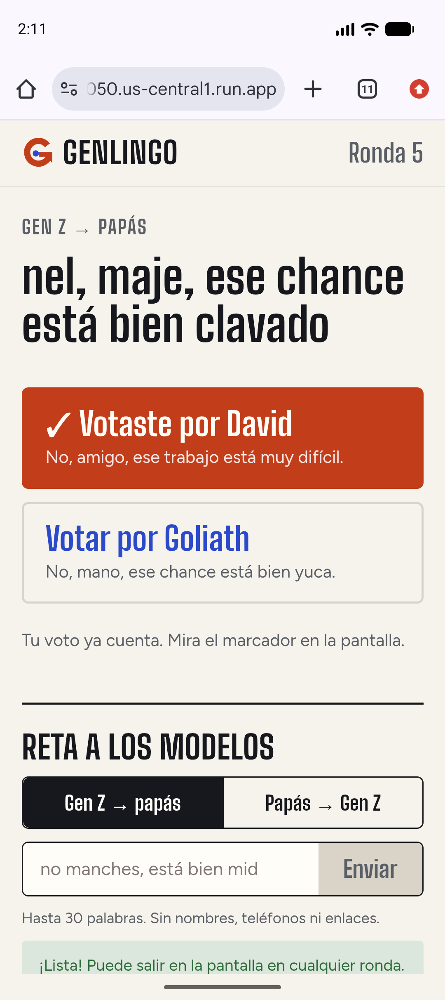
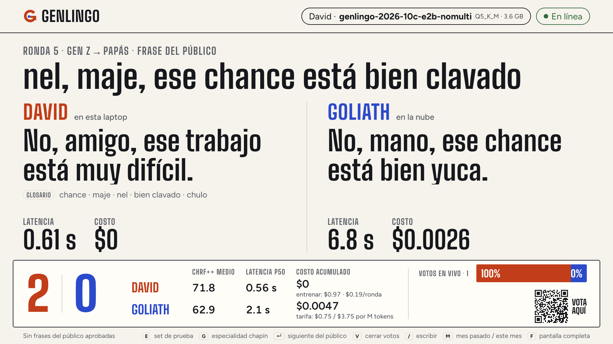
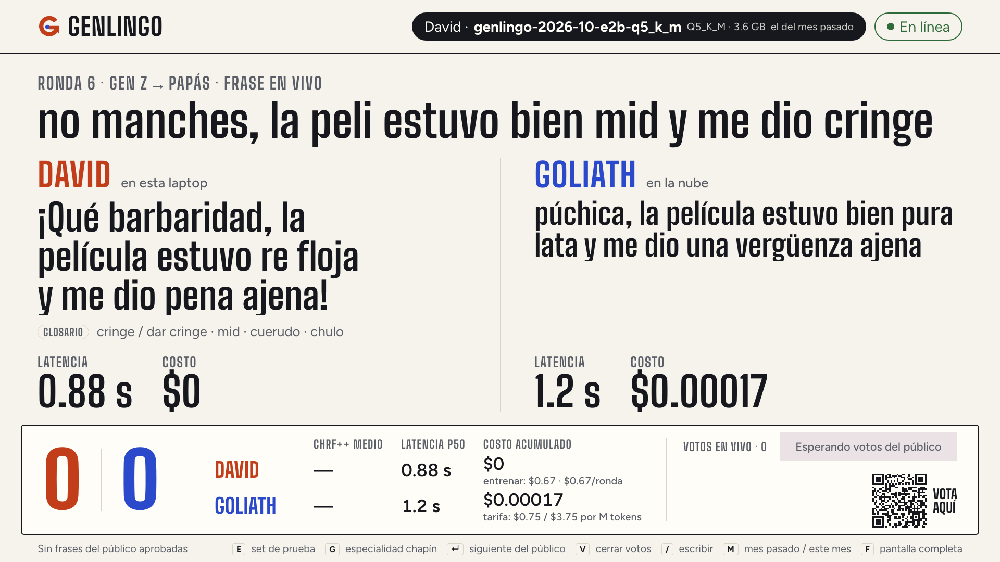
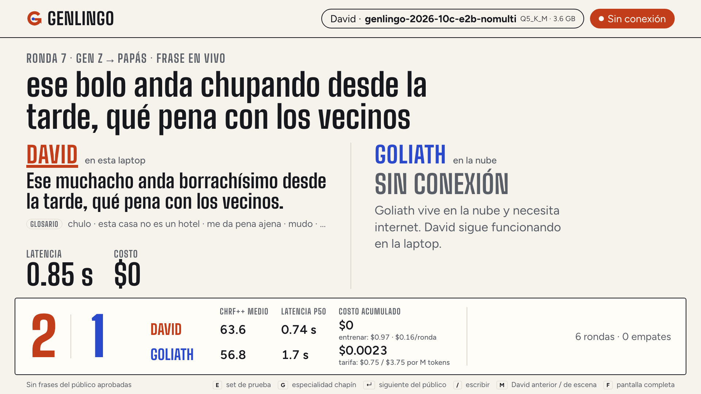

# Guion de la demo

El plan paso a paso de la demo en escena: qué hay que tener listo antes, qué teclear en cada pantalla, qué
decir y cuánto dura. Unos 11 minutos en total. La demo funciona sin público (pasos 2, 3, 4, 7 y 8) y sin
internet para David (paso 8).

Teclas de la vista del presentador: `E` set de prueba · `G` especialidad chapín · `/` escribir (`Tab`
cambia la dirección, `Esc` cancela) · `Enter` siguiente frase del público · `V` cerrar votos · `M` David del
mes anterior / de este mes · `F` pantalla completa.

## Antes de la demo

Una hora antes, en la laptop del escenario (M1 Max, cargada):

- [ ] `make up`. Arranca Ollama, precarga los dos Davids y EmbeddingGemma, levanta el duelo (`:8787`) y la
      vista del presentador (`:3000/presenter`). Si algo falla, dice qué y en qué línea.
- [ ] Salud: `curl -s localhost:8787/health`. Tiene que decir `"ollama": true`, `"online": true` y, en
      `david_models`, `Q5_K_M` para `genlingo-2026-10c-e2b-nomulti` y `genlingo-2026-10-e2b-q5_k_m`.
- [ ] Precalentamiento: una ronda `E`, una frase escrita en cada dirección, `M`, una frase, `M` de
      vuelta. `ollama ps` debe mostrar los dos Davids y `embeddinggemma`, nada más.
- [ ] `make reset`: marcador en cero (tarda menos de un segundo).
- [ ] Proyector: pantalla duplicada o extendida a 1920×1080, Chrome en `http://127.0.0.1:3000/presenter`,
      zoom 100 %, `F` para pantalla completa. Mira desde el fondo de la sala que el QR se lea.
- [ ] App del público: abre la URL de Cloud Run en el Chrome del emulador
      (`adb -s emulator-5556`) y en tu teléfono. Tiene que cargar «El duelo está por empezar.».
- [ ] Con público: `AUDIENCE_FEED=1` en `.env` y `make up` otra vez; con `AUTO_APPROVE_PHRASES=1` (por
      defecto en Cloud Run) las frases que pasan el filtro llegan solas a la fila.
- [ ] Prueba de Wi-Fi apagado: apaga el Wi-Fi, escribe una frase, comprueba «Sin conexión» y que David
      responde; vuelve a encender el Wi-Fi y espera a que el indicador diga «En línea».
- [ ] `make reset` otra vez, y deja la pantalla de bienvenida proyectada.

## Paso a paso

### 1 · Bienvenida y QR (1 min)



Pantalla inicial, sin tocar nada.

> Un modelo pequeño en esta laptop contra un gigante en la nube. Escaneen el código: van a mandar frases y votar.

### 2 · Ronda de evaluación (1.5 min)



```
E
```

Una frase del set de prueba con su referencia humana y el chrF++ de cada uno.

> Las frases de prueba son reales, de la web, y David nunca las vio al entrenar; el chrF++ mide cuánto se parece cada traducción a la referencia.

### 3 · Ronda de especialidad: slang chapín (1.5 min)



```
G
```

La siguiente frase guatemalteca del set de prueba, en un orden fijo con semilla: nadie la elige.

> Este es el terreno de David: jerga chapina, donde Gemini tiene pocos datos y nosotros investigamos 115 frases reales.

### 4 · Frase escrita, Gen Z → papás (1 min)



```
/
Qué onda, maje, no traigo pisto para el chinique, estoy bien pisado
Enter
```

> David responde en menos de un segundo y gratis; Goliath tarda varios segundos y cobra por cada frase.

### 5 · Frase escrita, papás → Gen Z (1 min)



```
/
Tab
Mijo, ese patojo es muy shute y anda armando bochinche
Enter
```

`Tab` cambia la dirección a «Papás → Gen Z» antes de escribir.

> La dirección difícil: hay que producir jerga real del país, no solo quitarla. Aquí es donde más mejoró David con datos reales.

### 6 · Frase del público (2 min)




En el Chrome del emulador (o un teléfono de la sala), en la URL de Cloud Run, escribe y envía:

```
nel, maje, ese chance está bien clavado
```

La fila de la pantalla muestra «1 frase del público en fila». En la laptop:

```
Enter
V
```

`Enter` lanza la ronda con la frase del público, el público vota desde el teléfono y `V` cierra la votación.

> La frase llegó del teléfono a la pantalla en menos de 3 segundos; el voto decide quién ganó.

### 7 · El David del mes anterior (1 min)



```
M
/
no manches, la peli estuvo bien mid y me dio cringe
Enter
M
```

`M` cambia al David anterior (`genlingo-2026-10-e2b-q5_k_m`); el marcador cuenta solo sus rondas. `M` otra vez vuelve al de escena.

> Reentrenar a David con los datos del mes cuesta 97 centavos de dólar; los modelos grandes envejecen al ritmo de su próxima versión.

### 8 · Wi-Fi apagado (1 min)



Apaga el Wi-Fi de la laptop y escribe:

```
/
ese bolo anda chupando desde la tarde, qué pena con los vecinos
Enter
```

Goliath aparece «Sin conexión» y David responde igual. Vuelve a encender el Wi-Fi.

> Goliath vive en la nube. David vive aquí: sin internet, sin costo por frase y sin mandar datos a nadie.

### 9 · Cierre con el marcador (30 s)

Sin teclas: el marcador queda en pantalla con victorias, chrF++ medio, latencia p50 y costo acumulado de
cada uno.

> Con los mismos datos, Gemini se acerca a David, pero en jerga chapina David sigue ganando; la ventaja de David son sus datos, y esos son nuestros.

## Si algo falla

| Síntoma | Qué hacer |
| --- | --- |
| La pantalla dice «Duelo sin respuesta» | El servicio del duelo se cayó: en la terminal de `make up`, `Ctrl+C` y `make up` otra vez (30 s). El marcador está en SQLite y se conserva. |
| David tarda más de 2 s en la primera ronda | Se descargó el modelo de memoria: haz una ronda de calentamiento (`/`, una frase corta) antes de seguir. |
| «David no está cargado en Ollama» | `ollama ps`; si no aparece, `make up` lo vuelve a precargar. Mientras tanto, sigue con rondas de Goliath. |
| Goliath tarda más de 10 s o falla | La red del lugar está lenta: sigue con David; el paso 8 ya cuenta esa historia. |
| El indicador dice «Sin conexión» con Wi-Fi encendido | El chequeo se refresca cada 3 s; espera o comprueba la red con `curl -sI https://aiplatform.googleapis.com`. |
| No llegan frases del público | Revisa `AUDIENCE_FEED=1` en `.env` y `"audience_feed": true` en `/health`. Plan B: escribe tú la frase con `/`. |
| El QR no se lee desde el fondo | Dicta la URL corta o compártela en el chat del evento; la app funciona igual. |
| Una frase del público tiene groserías | El filtro la bloquea antes de la fila; si pasa algo raro, `AUTO_APPROVE_PHRASES=0` y apruebas en `/admin`. |
| `E` o `G` dicen que no quedan frases | Ya se usaron todas: `make reset` (pierdes el marcador) o sigue con frases escritas. |
| El proyector corta la pantalla | Chrome a 1920×1080 y zoom 100 % (`Cmd+0`), `F` para pantalla completa. |
