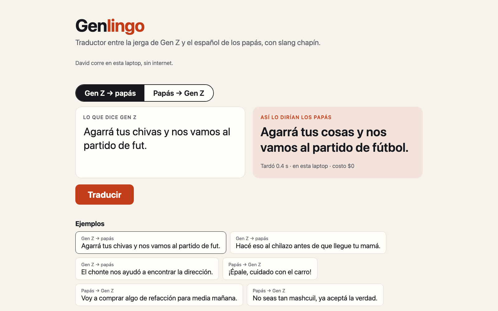
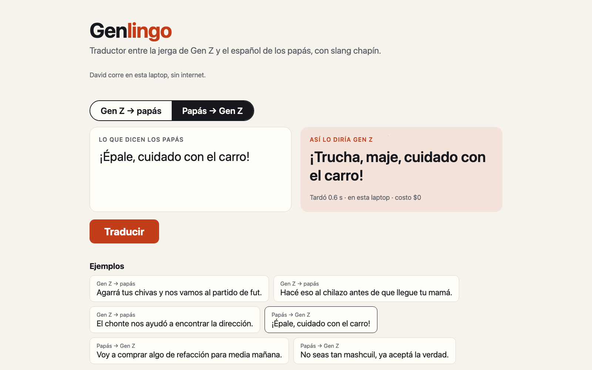

# Guion de la demo

La demo es una sola página: David traduce entre la jerga de Gen Z y el español de los papás, en la
laptop y sin internet. Se elige la dirección, se escribe una frase o se toca un ejemplo, y se pulsa
**Traducir**. Unos 3 minutos.

## Antes de la charla

Una hora antes, en la laptop del escenario (cargada):

- [ ] `make up` en una terminal. Arranca Ollama, carga a David y el modelo del glosario, y levanta la
      página.
- [ ] En otra terminal:

      ```bash
      make stage-on && make warmup && make preflight
      ```

      `preflight` revisa los modelos, la página y traduce en vivo cada ejemplo: los seis tienen que
      salir igual que cuando se verificaron. Tiene que terminar en «preflight ok»; cada `[FALLA]` dice
      cómo arreglarlo.
- [ ] Abre `http://127.0.0.1:8787/traducir` en Chrome, en pantalla completa, y comprueba que se lea
      desde el fondo de la sala.
- [ ] Toca un ejemplo una vez para que la primera traducción en escena no sea la más lenta.

Después de la charla: `make stage-off`.

## En escena

### 1 · La página (30 s)



> Esto es David: un modelo pequeño que corre en esta laptop, sin internet. Lo entrenamos con jerga
> real de Guatemala.

### 2 · De Gen Z a papás (1 min)

Toca dos ejemplos de «Gen Z → papás»:

| Ejemplo | Lo que responde David |
| --- | --- |
| Agarrá tus chivas y nos vamos al partido de fut. | Agarrá tus cosas y nos vamos al partido de fútbol. |
| Hacé eso al chilazo antes de que llegue tu mamá. | Hacé eso rapidito antes de que llegue tu mamá. |
| El chonte nos ayudó a encontrar la dirección. | El policía nos ayudó a encontrar la dirección. |

> «Chivas», «al chilazo», «chonte»: David sabe qué significan y lo dice como lo diría tu mamá, en
> menos de un segundo y sin costo.

### 3 · De papás a Gen Z (1 min)



Toca dos ejemplos de «Papás → Gen Z»:

| Ejemplo | Lo que responde David |
| --- | --- |
| ¡Épale, cuidado con el carro! | ¡Trucha, maje, cuidado con el carro! |
| Voy a comprar algo de refacción para media mañana. | Voy a comprar algo de refa para media mañana. |
| No seas tan mashcuil, ya aceptá la verdad. | No seas tan necio, maje, ya aceptá la verdad. |

> La dirección difícil: no basta con quitar la jerga, hay que poner la jerga correcta de aquí.

### 4 · Una frase escrita (30 s, opcional)

Escribe en el cuadro una frase con jerga chapina y pulsa **Traducir**.

> Cualquier frase, en vivo, en la laptop.

## De dónde salen los ejemplos

Los seis ejemplos están en `data/translate_examples.json`, con su fuente y su licencia. Son frases
de jerga chapina del set de prueba: David nunca las vio al entrenar. Cada una se tradujo cuatro
veces en vivo con el David de escena (`genlingo-2026-10c-e2b-nomulti`) y las cuatro salieron bien.
Se eligieron de Guatemala porque ahí es donde David acierta más jerga que Gemini (52 % contra 23 %,
[evals/report.md](../evals/report.md)).

Una frase escrita en vivo no está verificada de antemano: David puede equivocarse con jerga que no
conoce.

## Si algo falla

| Síntoma | Qué hacer |
| --- | --- |
| La página no abre | `make up` en una terminal; la página está en `http://127.0.0.1:8787/traducir`. |
| «David no respondió» | Ollama no está corriendo o no tiene a David: `ollama ps` y `make up` otra vez. |
| La primera traducción tarda más de 2 s | El modelo se había descargado de memoria: toca un ejemplo y sigue. |
| Un ejemplo responde distinto a la tabla | `make preflight` lo marca; revisa que `LOCAL_MODEL_TAG` en `.env` sea `genlingo-2026-10c-e2b-nomulti`. |
