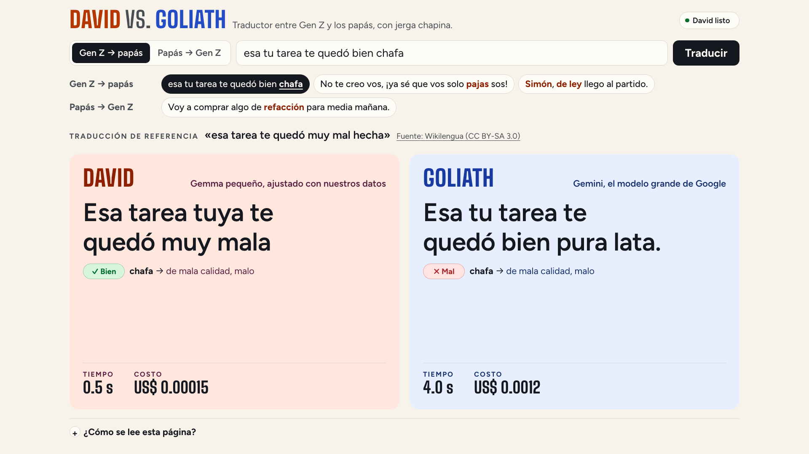

# Estructura del repositorio

Qué corre dónde, cómo se ve y dónde está cada cosa en el código. Volver al [README](../README.md). [English version](ESTRUCTURA.en.md).

## Arquitectura


Fuente editable: [diagrams/arquitectura.html](diagrams/arquitectura.html) (también en `.svg`). Por qué cada pieza corre donde corre: [DECISIONES.md](DECISIONES.md#david-en-la-nube).

- **La página** es un servicio público de Cloud Run en `us-central1`. El navegador solo habla con ella; ella llama a los dos modelos y devuelve cada respuesta en cuanto llega.
- **David** es un servicio privado de Cloud Run en `europe-west4` con una GPU NVIDIA L4: Ollama con el David de `DAVID_MODEL_TAG` y EmbeddingGemma dentro de la imagen. Solo la cuenta de servicio de la página puede llamarlo (token de identidad). Escala a cero cuando nadie lo usa; la página lo despierta al abrirse.
- **Goliath** es Gemini en Vertex AI, llamado desde la página.
- **Entrenar y evaluar** son Cloud Run Jobs con una L4 en `europe-west4`. El entrenamiento publica el GGUF en el bucket de modelos; de ahí salen la imagen de David y los modelos del eval.

El ciclo de cada mes, de los datos a la página y de vuelta:


## Pantallas




La demo de la charla es esa página; el guion está en [DEMO.md](DEMO.md).

## Mapa del repositorio

```
duel/                 La página de comparación (FastAPI) — corre en Cloud Run
  duel_core/          Núcleo reutilizable: las dos llamadas en paralelo, clientes Ollama/Gemini/mock,
                      costo con tarifas fechadas, chrF++, percentiles
  genlingo_duel/      La app: prompts, glosario de léxico, banco de términos, arena (David y Goliath),
                      API (main.py), revisión por término (term_check.py), ejemplos (translate_page.py),
                      token de identidad para David (cloud_auth.py) y la página (static/index.html)
  tests/              Pruebas (MOCK_AI=1)
  Dockerfile          Imagen de la página
david/                Imagen de David: Ollama con el modelo, EmbeddingGemma y los kernels de CUDA compilados (Dockerfile, start.sh,
                      fill-jit-cache.sh, cloudbuild.yaml)
data/                 terms.jsonl, raw/, pairs/, eval/, counterparts.jsonl, SOURCES.md, DATASHEET.md,
                      translate_examples.json (los ejemplos de la página, verificados en vivo)
scripts/              Construcción de datos, check_page.py (make check), check_candidates.py (make check-candidates), screenshots.py (make screenshots), bench_capacity.py (make capacity)
train/                train_lora.py, finish.py, preference.py, submit_job.py, notebook, runs/
evals/                run_eval.py, term_accuracy.py, report.py, report.md, experiments/,
                      Dockerfile + cloud_eval.sh (el job del eval)
infra/                Scripts gcloud numerados: 01–03 entrenamiento, 04 David, 05 la página, 06 el eval,
                      07 los kernels de CUDA de David
docs/                 DEMO, ONBOARDING, BITACORA, DECISIONES, COMANDOS, ESTRUCTURA, CREDITOS,
                      diagrams/ (HTML + SVG + PNG), demo/ (capturas de la página), data/capacity.json (make capacity)
```

## Versiones

| Pieza | Versión |
| --- | --- |
| Modelo base de David | Gemma 4 E2B (`gemma-4-E2B-it`, pesos de Hugging Face `hf://google`); comparado con E4B |
| Goliath | `gemini-3.8-flash` (`GEMINI_THINKING_LEVEL=low`) en Vertex AI |
| Embeddings del léxico | EmbeddingGemma (`embeddinggemma` en Ollama) |
| Ollama | 0.35.0 (imagen `ollama/ollama`), en Cloud Run con 1 NVIDIA L4, 4 vCPU y 16 GiB |
| Entrenamiento | torch 2.14.0 (CUDA 12.6), transformers 5.17.0, peft 0.21.1, trl 1.14.1, accelerate 1.15.0, datasets 5.0.1, llama.cpp `b11292` |
| La página | Python 3.12, fastapi 0.142.2, uvicorn 0.54.0, google-genai 2.25.0, google-auth 2.59.0, httpx 0.28.1, sacrebleu 2.6.0 |

Los modelos vienen de variables de entorno (`GEMINI_MODEL`, `GEMMA_BASE_MODEL`, `DAVID_MODEL_TAG`, `DAVID_TAGS`, `BASE_MODEL_TAGS`, `EMBEDDING_MODEL`), documentadas en `.env.example`. El proyecto no usa APIs en preview (ADK, MCP, A2A).
