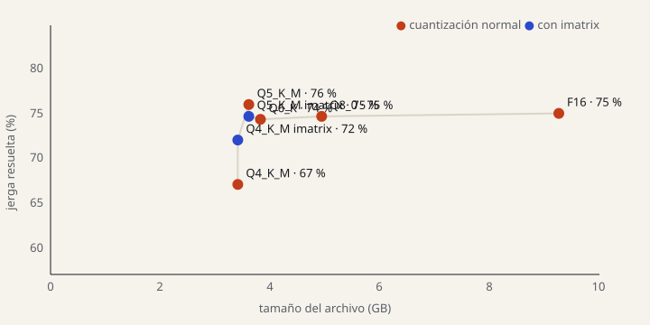

# Genlingo — evaluación

Generado por `make eval` el 2026-10-07 11:36. 399 pares de prueba (web; nunca sintéticos), 399 auto_validated. `auto_validated` = validada automáticamente contra el banco de términos (`scripts/validate_test_set.py`).

## Resumen

chrF++ de corpus (0–100, más es mejor) contra la referencia humana. Latencia de extremo a extremo con el modelo ya cargado; los modelos de Ollama corren uno a la vez en la GPU del job del eval.

| modelo | rol | prompt | chrF++ | p50 | p95 | costo total | costo / 1,000 frases | tamaño | errores |
| --- | --- | --- | --- | --- | --- | --- | --- | --- | --- |
| gemma4:e2b-it-qat | base (sin ajuste) | país | 50.3 | 151 ms | 223 ms | $0 | $0 | 4.34 GB | 0 |
| gemma4:e2b-it-qat + léxico | base (sin ajuste) | país + léxico | 54.9 | 213 ms | 287 ms | $0 | $0 | 4.34 GB | 0 |
| gemma4:e4b | base (sin ajuste) | país | 48.2 | 224 ms | 330 ms | $0 | $0 | 6.58 GB | 0 |
| gemini-3.8-flash | Goliath | país | 53.7 | 3.06 s | 7.93 s | $0.46 | $1.14 | — | 0 |
| gemini-3.8-flash + léxico | Goliath con el glosario de David | país + léxico | 56.4 | 3.20 s | 7.69 s | $0.54 | $1.36 | — | 0 |
| genlingo-2026-10-e2b + glosario | David candidato (LoRA, Q4_K_M) | país + glosario | 55.7 | 196 ms | 291 ms | $0 | $0 | 3.42 GB | 0 |
| genlingo-2026-10-e2b-f16 + glosario | David candidato (LoRA, f16) | país + glosario | 56.2 | 358 ms | 568 ms | $0 | $0 | 9.27 GB | 0 |
| genlingo-2026-09 | David candidato (LoRA, Q4_K_M) | básico | 54.9 | 157 ms | 237 ms | $0 | $0 | 3.42 GB | 0 |
| genlingo-2026-10b-e2b + glosario | David candidato (LoRA, Q5_K_M) | país + glosario | 56.4 | 206 ms | 314 ms | $0 | $0 | 3.62 GB | 0 |
| genlingo-2026-10-e2b-q5_k_m + glosario | David candidato (LoRA, Q5_K_M) | país + glosario | 55.4 | 212 ms | 308 ms | $0 | $0 | 3.62 GB | 0 |
| genlingo-2026-10d-e2b + léxico | David (LoRA, Q5_K_M) | país + léxico | 60.0 | 237 ms | 331 ms | $0 | $0 | 3.62 GB | 0 |
| genlingo-2026-10d-e2b-f16 + léxico | David (LoRA, f16) | país + léxico | 59.7 | 378 ms | 566 ms | $0 | $0 | 9.27 GB | 0 |
| genlingo-2026-10c-e2b-nomulti + léxico | David candidato (LoRA, Q5_K_M) | país + léxico | 59.5 | 236 ms | 326 ms | $0 | $0 | 3.62 GB | 0 |
| genlingo-2026-10c-e2b-nomulti-f16 + léxico | David candidato (LoRA, f16) | país + léxico | 59.5 | 377 ms | 564 ms | $0 | $0 | 9.27 GB | 0 |

Costo de Goliath con la tarifa del día del eval: $0.75 entrada / $3.75 salida por millón de tokens (vigente desde 2026-09-30).
Con la tarifa desde 2027-01-01 ($1.50 / $7.50), este mismo eval costaría $0.91 ($2.28 por 1,000 frases).

**Línea base "copiar la frase"** (devolver el texto original sin traducir): chrF++ 53.2. Un modelo que no supera esta línea no está traduciendo mejor que no hacer nada; mide cuánto del puntaje viene de palabras que la referencia comparte con el original.

## ¿Tradujo la jerga?

chrF++ premia parecerse a la referencia, y una reescritura de registro conserva casi todas las palabras: por eso copiar la frase ya saca ~50. Estas dos métricas miran solo lo que tenía que cambiar (detalle en `evals/term_accuracy.py`):

- **Jerga resuelta**: Gen Z → papás, no queda en la salida ningún término Gen Z del banco que tenía la frase; papás → Gen Z, la salida usa al menos un término Gen Z del banco del país. Mide que cambió el registro, no que el significado sea correcto.
- **Cambios acertados**: de las palabras que la referencia humana cambió respecto al original, cuántas aparecen en la salida. Mide significado, pero solo con palabras exactas: un sinónimo válido cuenta como fallo para todos.

- **Jerga correcta** y **cambios acertados con sinónimos** (enmienda 1 de `evals/niche.md`): el término producido tiene que significar lo mismo, según la tabla de contrapartes validada por significado (`data/counterparts.jsonl`); con sinónimos, una palabra cuenta si coincide la raíz o es un término enlazado.

| modelo | jerga resuelta Gen Z → papás | jerga resuelta papás → Gen Z | jerga resuelta total | cambios acertados | jerga correcta | cambios acertados (sinónimos) |
| --- | --- | --- | --- | --- | --- | --- |
| copiar la frase (línea base) | 0 % (n=226) | 3 % (n=173) | 1 % (n=399) | 0 % | 1 % (n=399) | 4 % |
| gemma4:e2b-it-qat | 94 % (n=226) | 10 % (n=173) | 58 % (n=399) | 14 % | 14 % (n=399) | 17 % |
| gemma4:e2b-it-qat + léxico | 98 % (n=226) | 16 % (n=173) | 62 % (n=399) | 24 % | 42 % (n=399) | 28 % |
| gemma4:e4b | 98 % (n=226) | 31 % (n=173) | 69 % (n=399) | 17 % | 18 % (n=399) | 21 % |
| gemini-3.8-flash | 96 % (n=226) | 51 % (n=173) | 77 % (n=399) | 25 % | 24 % (n=399) | 28 % |
| gemini-3.8-flash + léxico | 99 % (n=226) | 63 % (n=173) | 83 % (n=399) | 28 % | 41 % (n=399) | 31 % |
| genlingo-2026-10-e2b + glosario | 96 % (n=226) | 30 % (n=173) | 67 % (n=399) | 16 % | 26 % (n=399) | 19 % |
| genlingo-2026-10-e2b-f16 + glosario | 98 % (n=226) | 41 % (n=173) | 73 % (n=399) | 19 % | 28 % (n=399) | 22 % |
| genlingo-2026-09 | 93 % (n=226) | 21 % (n=173) | 62 % (n=399) | 14 % | 17 % (n=399) | 18 % |
| genlingo-2026-10b-e2b + glosario | 99 % (n=226) | 57 % (n=173) | 81 % (n=399) | 22 % | 33 % (n=399) | 26 % |
| genlingo-2026-10-e2b-q5_k_m + glosario | 97 % (n=226) | 42 % (n=173) | 73 % (n=399) | 18 % | 26 % (n=399) | 21 % |
| genlingo-2026-10d-e2b + léxico | 100 % (n=226) | 54 % (n=173) | 80 % (n=399) | 28 % | 44 % (n=399) | 32 % |
| genlingo-2026-10d-e2b-f16 + léxico | 100 % (n=226) | 62 % (n=173) | 84 % (n=399) | 28 % | 43 % (n=399) | 31 % |
| genlingo-2026-10c-e2b-nomulti + léxico | 100 % (n=226) | 59 % (n=173) | 82 % (n=399) | 28 % | 41 % (n=399) | 32 % |
| genlingo-2026-10c-e2b-nomulti-f16 + léxico | 99 % (n=226) | 58 % (n=173) | 81 % (n=399) | 28 % | 43 % (n=399) | 32 % |

**David de la página:** `genlingo-2026-10c-e2b-nomulti + léxico` (3.62 GB, p50 236 ms): el archivo más pequeño a ≤ 2 puntos de `genlingo-2026-10d-e2b-f16 + léxico` (84 % de jerga resuelta), con p50 < 1 s (empate de tamaño: gana el mayor chrF++). Resuelve 82 %.

Cara a cara con `gemini-3.8-flash` en jerga resuelta: David la resuelve y Goliath no en **56** frases; al revés en **36**.

Cara a cara con `gemini-3.8-flash + léxico` en jerga resuelta: David la resuelve y Goliath no en **30** frases; al revés en **36**.

Jerga de otro país en papás → Gen Z (p. ej. «pisto» guatemalteco en una frase mexicana): gemma4:e2b-it-qat 7, gemma4:e2b-it-qat + léxico 8, gemma4:e4b 16, gemini-3.8-flash 5, gemini-3.8-flash + léxico 0, genlingo-2026-10-e2b + glosario 20, genlingo-2026-09 20, genlingo-2026-10b-e2b + glosario 17, genlingo-2026-10-e2b-q5_k_m + glosario 16, genlingo-2026-10d-e2b + léxico 10, genlingo-2026-10c-e2b-nomulti + léxico 17 (de 173).

**Lectura:** David gana también en jerga, no solo en parecido de superficie, frente a Goliath sin glosario. Compáralo con Goliath + glosario para separar lo que aporta el modelo de lo que aporta el dato.

Con el mismo glosario, Goliath resuelve 83 % de la jerga frente al 82 % de David: la ventaja de David viene de **sus datos** (el banco de términos), no de ser mejor modelo; y esos datos los tiene él, no Goliath.

## Compresión: tamaño vs jerga

Las exportaciones de `genlingo-2026-10-e2b` con el mismo prompt y glosario. La curva muestra cuánta jerga se pierde al comprimir.

| variante | cuantización | imatrix | tamaño | jerga resuelta | cambios acertados | chrF++ | p50 |
| --- | --- | --- | --- | --- | --- | --- | --- |
| `genlingo-2026-10-e2b + glosario` | Q4_K_M | no | 3.42 GB | 67 % | 16 % | 55.7 | 196 ms |
| `genlingo-2026-10-e2b-q5_k_m + glosario` | Q5_K_M | no | 3.62 GB | 73 % | 18 % | 55.4 | 212 ms |
| `genlingo-2026-10-e2b-f16 + glosario` | F16 | no | 9.27 GB | 73 % | 19 % | 56.2 | 358 ms |

**imatrix (importance matrix):** antes de cuantizar, llama.cpp pasa el modelo f16 por texto de calibración y mide qué pesos influyen más; la cuantización gasta los bits ahí. Calibramos con **pares de entrenamiento** renderizados con el prompt de David (`train/quant_sweep.py`), nunca con el set de prueba: eso inflaría el eval.

### chrF++ por origen

| modelo | web |
| --- | --- |
| gemma4:e2b-it-qat | 50.3 (n=399) |
| gemma4:e2b-it-qat + léxico | 54.9 (n=399) |
| gemma4:e4b | 48.2 (n=399) |
| gemini-3.8-flash | 53.7 (n=399) |
| gemini-3.8-flash + léxico | 56.4 (n=399) |
| genlingo-2026-10-e2b + glosario | 55.7 (n=399) |
| genlingo-2026-10-e2b-f16 + glosario | 56.2 (n=399) |
| genlingo-2026-09 | 54.9 (n=399) |
| genlingo-2026-10b-e2b + glosario | 56.4 (n=399) |
| genlingo-2026-10-e2b-q5_k_m + glosario | 55.4 (n=399) |
| genlingo-2026-10d-e2b + léxico | 60.0 (n=399) |
| genlingo-2026-10d-e2b-f16 + léxico | 59.7 (n=399) |
| genlingo-2026-10c-e2b-nomulti + léxico | 59.5 (n=399) |
| genlingo-2026-10c-e2b-nomulti-f16 + léxico | 59.5 (n=399) |

### chrF++ por dirección

| modelo | genz_to_parent | parent_to_genz |
| --- | --- | --- |
| gemma4:e2b-it-qat | 56.8 (n=226) | 41.2 (n=173) |
| gemma4:e2b-it-qat + léxico | 64.6 (n=226) | 41.4 (n=173) |
| gemma4:e4b | 54.9 (n=226) | 38.9 (n=173) |
| gemini-3.8-flash | 61.4 (n=226) | 43.1 (n=173) |
| gemini-3.8-flash + léxico | 62.7 (n=226) | 47.7 (n=173) |
| genlingo-2026-10-e2b + glosario | 62.5 (n=226) | 46.1 (n=173) |
| genlingo-2026-10-e2b-f16 + glosario | 63.3 (n=226) | 46.3 (n=173) |
| genlingo-2026-09 | 62.3 (n=226) | 44.6 (n=173) |
| genlingo-2026-10b-e2b + glosario | 63.6 (n=226) | 46.5 (n=173) |
| genlingo-2026-10-e2b-q5_k_m + glosario | 62.7 (n=226) | 45.3 (n=173) |
| genlingo-2026-10d-e2b + léxico | 68.3 (n=226) | 48.6 (n=173) |
| genlingo-2026-10d-e2b-f16 + léxico | 67.8 (n=226) | 48.4 (n=173) |
| genlingo-2026-10c-e2b-nomulti + léxico | 67.3 (n=226) | 48.6 (n=173) |
| genlingo-2026-10c-e2b-nomulti-f16 + léxico | 67.3 (n=226) | 48.8 (n=173) |

### chrF++ por país

| modelo | CO | GT | LATAM | MX |
| --- | --- | --- | --- | --- |
| gemma4:e2b-it-qat | 48.6 (n=131) | 53.6 (n=115) | 50.5 (n=75) | 48.5 (n=78) |
| gemma4:e2b-it-qat + léxico | 52.3 (n=131) | 60.4 (n=115) | 56.3 (n=75) | 50.6 (n=78) |
| gemma4:e4b | 48.0 (n=131) | 49.4 (n=115) | 48.0 (n=75) | 46.7 (n=78) |
| gemini-3.8-flash | 52.9 (n=131) | 53.0 (n=115) | 59.7 (n=75) | 49.7 (n=78) |
| gemini-3.8-flash + léxico | 54.0 (n=131) | 59.8 (n=115) | 60.1 (n=75) | 52.2 (n=78) |
| genlingo-2026-10-e2b + glosario | 55.9 (n=131) | 61.4 (n=115) | 52.2 (n=75) | 50.4 (n=78) |
| genlingo-2026-10-e2b-f16 + glosario | 56.4 (n=131) | 61.9 (n=115) | 53.2 (n=75) | 50.7 (n=78) |
| genlingo-2026-09 | 54.2 (n=131) | 58.1 (n=115) | 54.5 (n=75) | 51.7 (n=78) |
| genlingo-2026-10b-e2b + glosario | 57.6 (n=131) | 61.6 (n=115) | 51.9 (n=75) | 51.4 (n=78) |
| genlingo-2026-10-e2b-q5_k_m + glosario | 56.2 (n=131) | 61.0 (n=115) | 51.9 (n=75) | 49.5 (n=78) |
| genlingo-2026-10d-e2b + léxico | 60.9 (n=131) | 66.1 (n=115) | 56.1 (n=75) | 53.6 (n=78) |
| genlingo-2026-10d-e2b-f16 + léxico | 60.8 (n=131) | 66.0 (n=115) | 55.7 (n=75) | 52.2 (n=78) |
| genlingo-2026-10c-e2b-nomulti + léxico | 59.6 (n=131) | 65.1 (n=115) | 56.6 (n=75) | 54.0 (n=78) |
| genlingo-2026-10c-e2b-nomulti-f16 + léxico | 59.6 (n=131) | 65.6 (n=115) | 56.8 (n=75) | 53.3 (n=78) |

## Modelo base: E2B vs E4B

Regla: el más pequeño que cumpla p50 < 1 s con el mejor chrF++.

**gemma4:e2b-it-qat**: mejor chrF++ (50.3) entre los que cumplen p50 < 1 s (p50 151 ms, 4.34 GB).

## Compresión: f16 vs Q5_K_M

| versión | tamaño | p50 | chrF++ |
| --- | --- | --- | --- |
| f16 | 9.27 GB | 378 ms | 59.7 |
| Q5_K_M | 3.62 GB | 237 ms | 60.0 |

## Entrenamiento

| tag | máquina | región | ejemplos | duración | costo estimado | loss inicial → final |
| --- | --- | --- | --- | --- | --- | --- |
| genlingo-2026-10d-e2b | Cloud Run Jobs: 1x NVIDIA L4 + 8 vCPU/32 GiB (train), 8 vCPU/32 GiB (merge + GGUF) | europe-west4 | 3880 | 67.5 min | $1.49 | 2.08 → 0.05 |

Costo = segundos facturados × tarifas por segundo de Cloud Run (GPU L4 sin redundancia zonal + vCPU + memoria; entrenamiento en la L4 + fusión y GGUF en un job de CPU). Un reentrenamiento mensual cuesta eso.

## Dónde pierde David

David gana 236 de 399 frases por chrF++ de oración. Las 10 peores derrotas entre las frases de fuentes abiertas (las demás no se pueden reproducir aquí):

| frase | referencia | David | Goliath | Δ chrF++ |
| --- | --- | --- | --- | --- |
| Se pegó en la shola con la puerta. | Se pegó en la cabeza con la puerta. | Se golpeó la cabeza con la puerta. | Se pegó en la cabeza con la puerta. | -26.6 |
| Esa historia es pura paja. | Esa historia es pura mentira. | Esa historia no es nada de verdad. | Esa historia es pura casaca. | -26.1 |
| Güey, le mandé el mensaje a mi ex por error, qué oso. | Oye, le mandé el mensaje a mi ex por equivocación, qué vergüenza. | Amigo, le mandé el mensaje a mi ex por error, ¡trágame tierra! | Híjole, le mandé el mensaje a mi ex por equivocación, qué pena me dio. | -25.7 |
| Qué chulo tu chucho, colocho. | Qué calidá tu perro, colocho. | Qué nítido tu chucho, maje. | Qué top tu chucho, colocho. | -23.9 |
| Te vi muy encarretado con tus amigos en el parque | Te vi muy entretenido con tus amigos en el parque. | Te vi muy enamorado con tus amigos en el parque | Te vi muy entretenido con tus amigos en el parque | -21.6 |
| Chish, no entres al baño, está bien sucio. | Ay no, no entrés al baño, está muy sucio. | No te acerques al baño, está sucio. | Qué asco, no entrés al baño, está bien shuco. | -17.3 |
| Qué cuerudo sos, no te da vergüenza nada. | Qué descarado sos, maje, cero pena. | Qué descarado sos, no te da pena nada. | Qué descarado sos, cero pena te da nada. | -15.9 |
| jovencita no siga ahí acostada, pongase las pilas | Amiga, no se quede ahí tirada, pilas pues | Nena, no te quedes ahí pasmada, ¡despierta! | Mor, no se quede ahí echada, actívese. | -14.8 |
| Casi todos los días me jarto mis polas (cervezas) | Casi todos los días me tomo mis cervezas. | Casi todos los días me antojo de una cerveza. | Casi todos los días me tomo mis amargas | -12.8 |
| Vieras que me pasó algo bien curioso. | Maje, no sabés lo que me pasó, bien random. | Ponte trucha que me pasó algo bien curioso. | Mano, me pasó algo bien random. | -12.5 |

## Metodología

- Prompts en `duel/genlingo_duel/prompts.py`, temperatura 0. Cada variante declara su prompt en la tabla: cada David con el prompt con el que se entrenó; los modelos base y Goliath con el prompt con país, y también con el glosario de David («+ glosario») para que la comparación con los datos de David sea justa y visible.
- Glosario: entradas del banco de términos recuperadas con EmbeddingGemma local; su tiempo cuenta en la latencia.
- chrF++ = sacrebleu CHRF con `word_order=2`, a nivel de corpus.
- Costo de Goliath = tokens × precio por millón vigente el día del eval (`GEMINI_PRICE_SCHEDULE`); los tokens de razonamiento se cobran como salida.
- Resultados por frase en `evals/results/`.
